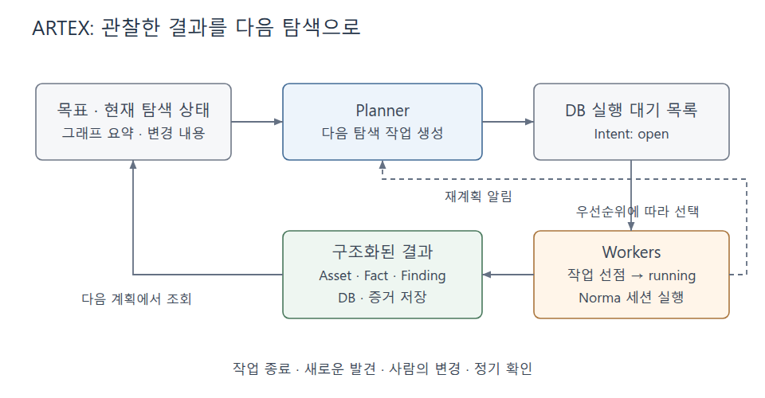
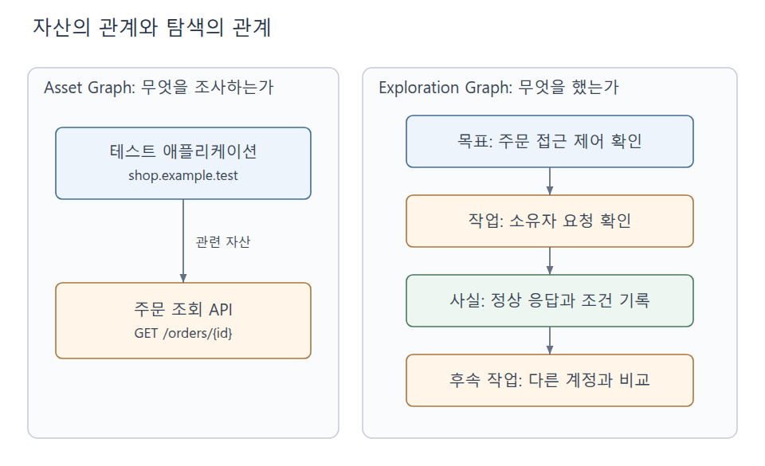
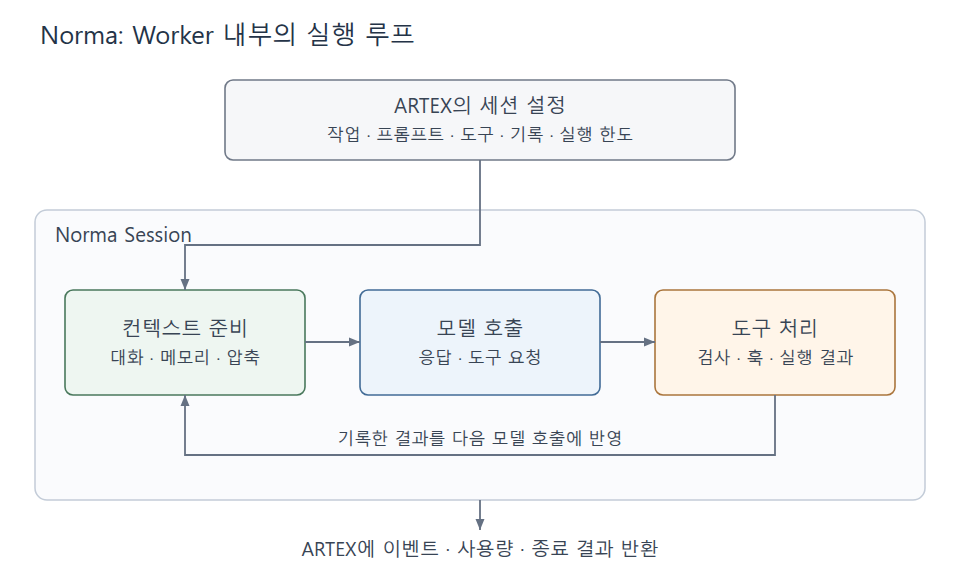
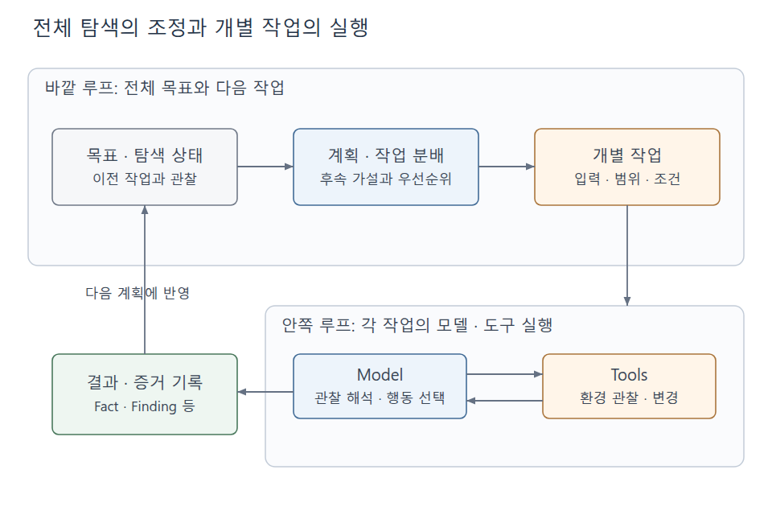

+++
date = '2026-10-11T21:00:00+09:00'
draft = false
title = '[Analysis] AI 자율 침투테스트 아키텍처 분석 — ARTEX의 Harness와 Agentic Flow'
summary = 'ARTEX와 Norma의 코드를 따라 계획·작업 분배·도구 실행·결과 기록이 연결되는 구조를 분석하고, PentestGPT·Strix·Shannon 등과 설계 차이를 비교한다.'
toc = true
tags = ['AI', 'Pentest', 'Agent', 'Harness', 'ARTEX', 'Norma']
+++

---

## 들어가며

웹 진단에서 요청 하나가 성공했다고 취약점 확인이 끝나지는 않는다. 주문 조회 API라면 누가 보낸 요청인지, 주문의 소유자는 누구인지, 응답에 실제 주문 정보가 들어 있는지를 함께 봐야 한다. 그 결과에 따라 다른 계정으로 비교하거나, 인증 조건을 다시 확인하는 작업이 이어진다. 사람이 진단할 때는 프록시 기록과 메모, 할 일 목록을 오가며 이 과정을 연결한다.

이런 일을 AI가 수행한다는 사례도 이제 어렵지 않게 접할 수 있다. 2026년 10월 2일 [YTN 보도](https://www.ytn.co.kr/_ln/0102_202610022245253425)는 신한은행 공격에 쓰인 것으로 보이는 웹서버에서 ARTEX AI가 남긴 것으로 의심되는 흔적이 발견됐다는 보안업계 분석을 전했다.

취약점 연구에서 보고된 성과도 있다. HackerOne은 2025년 6월 XBOW가 평판 점수 기준 [미국 리더보드 1위에 올랐다고 발표했다](https://www.hackerone.com/blog/ai-hackbots-security-testing-update). 2026년 4월 공개된 Linux 커널의 로컬 권한 상승 취약점 [Copy Fail(CVE-2026-31431)](https://xint.io/blog/copy-fail-linux-distributions)은 Theori 연구자가 얻은 단서를 바탕으로 Xint Code가 분석 범위를 확장한 사례다. 연구팀은 2017년의 변경 이후 약 9년간 존재했던 문제로 설명한다.

이런 사례를 보면 AI가 실제 조사 과정에 어떻게 참여하는지 궁금해진다. 앞의 주문 API 진단을 맡긴다면 모델이 요청을 만드는 능력만으로는 부족하다. 방금 확인한 조건을 남기고, 아직 확인하지 않은 부분을 골라 다음 요청으로 이어가야 하기 때문이다.

이번 글에서는 ARTEX와 이 도구가 사용하는 Norma의 코드를 따라 그 연결을 살펴본다. 먼저 전체 진단에서 다음 작업을 정하는 과정을 보고, 작업 하나를 수행하는 내부로 들어간다. 이후 결과가 저장되고 완료로 판정되는 지점까지 확인한 뒤 PentestGPT·Strix·Shannon 등의 설계와 비교한다.

---

## 확인한 결과에서 다음 작업을 만들기

테스트 계정 A가 자신의 주문을 조회할 수 있다는 것을 확인했다고 가정하자. 다음으로 다른 테스트 계정 B도 A의 주문을 읽을 수 있는지 확인해야 한다. 이때 다음 작업에는 API 주소와 함께 주문의 소유자, 정상 요청에 사용한 세션, 비교할 응답이 전달돼야 한다.

ARTEX는 목표와 테스트 범위를 입력받아 이러한 탐색 작업을 만들고, 여러 Worker가 수행한 결과를 다음 계획에 반영하는 보안 탐색 애플리케이션이다. 분석 기준은 2026년 10월 4일의 커밋 [`b55ceb1`](https://github.com/Autumn-27/ARTEX/tree/b55ceb1fdd84a813d77de09a06af83d323a81f85)이다. 세부 모듈·API·DB 동작은 [직접 분석해 정리한 ARTEX 문서](https://docs.mingon.dev/projects/artex/docs/)에서 확인할 수 있다.

### 다음 작업을 정하는 Planner와 실행하는 Worker

계정 B의 요청을 확인하는 일을 곧바로 실행 함수에 넣으면 순서가 정해진 자동화는 만들 수 있다. 하지만 B의 세션이 만료됐거나, 주문 조회 전에 다른 조건이 필요하다는 응답을 받으면 조사 순서를 바꿔야 한다. ARTEX에서는 현재 상태를 읽고 작업을 만드는 Planner와, 만들어진 작업을 맡아 수행하는 Worker를 나눈다.

다음 그림에서는 Worker의 결과가 어디로 돌아가는지를 보면 된다.



*그림 1. ARTEX의 탐색 흐름을 단순화한 도식.*

위쪽에서 Planner가 만든 작업은 DB의 실행 대기 목록으로 들어간다. Worker는 여기서 작업을 선점해 실행하고, 관찰한 결과를 아래쪽의 구조화된 상태로 기록한다. 이 상태를 다음 Planner가 읽으면 앞선 결과에 맞춰 후속 작업을 만들 수 있다. 그림의 알림 화살표는 계획을 다시 살펴볼 계기를 전달하며, 실행할 작업 자체는 DB의 상태를 기준으로 결정한다.

[태스크 엔진의 `Run`](https://github.com/Autumn-27/ARTEX/blob/b55ceb1fdd84a813d77de09a06af83d323a81f85/server/engine.go#L748)은 태스크마다 계획 루프와 여러 Worker 루프를 실행한다. 대기 작업은 우선순위가 높은 순서로 선택하고, 같은 우선순위에서는 ID 순서를 따른다. 이때 작업 하나를 가리키는 이름이 **Intent**다. Planner와 Worker의 책임 분담을 의사코드로 표현하면 다음과 같다.

```python
def planning_round(change):
    snapshot = read_goals_graph_and_todos()
    run_planner(snapshot, change)

def worker_loop():
    while task_is_active():
        intent = claim_next_open_intent()
        if intent is None:
            wait_for_work()
            continue

        terminal = run_worker_session(intent)
        update_intent_state(intent, terminal)
        notify_planner(intent.id, terminal)
```

여기서 `claim_next_open_intent()`는 실행할 작업을 가져오면서 상태를 `open`에서 `running`으로 바꾼다. Worker 세션이 끝나면 그 종료 결과에 맞춰 작업 상태를 갱신하고 Planner에 알린다. Planner는 현재 목표와 그래프 요약, 변경 내용을 입력으로 받으므로 앞의 진단을 매번 처음부터 시작할 필요가 없다. 작업 종료 외에도 새로운 발견, 사람의 목표 변경, 정기 확인이 재계획의 계기가 된다. 세부 흐름은 [태스크 탐색 문서](https://docs.mingon.dev/projects/artex/docs/features/task-exploration)에 정리했다.

이제 작업을 넘기고 다시 계획하는 순서는 알 수 있다. 다만 그림의 ‘구조화된 결과’에 무엇을 넣느냐에 따라 다음 계획이 할 수 있는 일도 달라진다. API 주소 하나만 저장했다면, 계정 A의 요청을 이미 확인했다는 사실부터 다시 찾아야 한다.

### 조사 대상과 조사 과정을 따로 남기는 이유

주문 API는 계정 A로 요청하든 B로 요청하든 같은 조사 대상이다. 하지만 진단이 진행되면서 이 대상에 관해 알고 있는 내용은 바뀐다. 처음에는 주소만 알고 있다가 정상 요청을 확보하고, 이후 다른 계정과의 비교 결과를 얻게 된다.

ARTEX의 **Asset Graph**는 자산과 자산 사이의 관계를 다룬다. **Exploration Graph**는 목표, Intent, 관찰 결과인 Fact, 발견 사항인 Finding 등의 관계를 다룬다. 같은 주문 API를 두 그래프에서 어떻게 바라보는지 비교하면 역할이 드러난다.



*그림 2. 주문 API를 자산과 탐색 과정으로 나누어 기록한 예시.*

왼쪽에서는 테스트 애플리케이션과 주문 조회 API가 연결된다. 오른쪽에서는 소유자 요청을 확인한 작업에서 정상 응답과 조건이 기록되고, 그 사실을 바탕으로 다른 계정과 비교하는 작업이 이어진다. 다음 Planner에 필요한 것은 오른쪽의 진행 상태까지 포함한 정보다.

| 기록할 내용 | 주문 API 사례 | 다음 판단에 쓰이는 방식 |
|---|---|---|
| 자산 | 테스트 애플리케이션과 주문 조회 API | 조사 대상을 식별한다 |
| 탐색 작업 | 소유자 계정의 주문 조회 요청 확인 | 지금 수행할 일을 정한다 |
| 사실 | 소유자의 세션으로 주문 내용을 받음 | 확인된 조건을 후속 작업에 전달한다 |
| 후속 작업 | 다른 계정으로 같은 주문 조회 | 아직 확인하지 않은 조건을 비교한다 |
| 발견 사항 | 소유자가 아닌 계정에도 주문 내용이 노출됨 | 취약점 결론과 근거를 연결한다 |

표의 마지막 행에 해당하는 결론을 내리려면 응답 내용과 계정의 권한을 함께 확인해야 한다. 오류 메시지를 `200`으로 반환하는 서비스도 있으므로 상태 코드만으로는 접근 성공을 판단하기 어렵다.

Worker는 기록 도구를 호출해 자산·사실·발견 사항을 구조화된 상태에 반영한다. 대화에서 얻은 정보를 저장해야 다음 Planner가 작업의 근거로 읽을 수 있다. [에이전트 런타임](https://docs.mingon.dev/projects/artex/docs/modules/agent-runtime)과 [발견 사항 문서](https://docs.mingon.dev/projects/artex/docs/features/findings-evidence)에서 이 연결을 확인할 수 있다.

그렇다면 Worker는 요청을 보내고 응답을 읽은 뒤, 어떤 과정을 거쳐 기록 도구까지 호출하는가? 앞의 의사코드에서 한 줄로 남겨 둔 `run_worker_session()` 안을 살펴볼 차례다.

---

## Worker 안에서 요청과 관찰을 이어가는 Norma

Worker가 받은 일은 ‘계정별 주문 접근 권한을 비교하라’는 작업이다. 수행 중 세션 만료를 확인했다면 인증 상태를 살펴봐야 하고, 정상 응답을 받았다면 주문 내용을 비교해야 한다. 이처럼 모델의 판단에 따라 도구를 실행하고 그 결과를 다시 모델에 넣는 실행 기반이 필요하다.

ARTEX는 같은 개발자의 프로젝트인 **Norma**를 사용한다. Norma는 범용 에이전트를 구성하고 실행하는 Go SDK다. 분석한 ARTEX의 `go.mod`는 `v0.4.3`을 요구하며, 여기서는 커밋 `320ae32989da97dd91469bb89164cbfe87d83d5d`를 기준으로 살펴봤다. 해당 버전의 동작은 [Norma 코드 분석 문서](https://docs.mingon.dev/projects/norma/docs/)에 정리했다.

### 작업을 실행할 세션 구성하기

이번 작업에 필요한 역할과 도구는 ARTEX가 구성해 Norma에 전달한다. [Worker 구현](https://github.com/Autumn-27/ARTEX/blob/b55ceb1fdd84a813d77de09a06af83d323a81f85/agent/worker.go#L431)의 옵션에서 어떤 값을 넘기는지 보면 그 경계를 알 수 있다. 아래는 핵심 필드만 발췌한 코드다.

```go
opts := agentcore.Options{
    Provider:     w.prov,
    SystemPrompt: system,
    Tools:        tools,
    WorkingDir:   runDir,
    MaxTurns:     w.maxTurns,
}
```

모델 제공자와 프롬프트뿐 아니라 사용할 도구, 작업 디렉터리, 실행 한도도 들어간다. 실제 옵션에는 권한·훅, 프록시, 대화 저장소, 컨텍스트 압축과 종료 정리 설정이 추가된다. Worker는 이 옵션으로 [`agentcore.NewSession(opts)`](https://github.com/Autumn-27/ARTEX/blob/b55ceb1fdd84a813d77de09a06af83d323a81f85/agent/worker.go#L497)를 호출하고, 기존 대화가 있으면 재개한 뒤 작업을 실행한다.

따라서 같은 Norma 세션이라도 ARTEX가 어떤 프롬프트와 도구를 전달했는지에 따라 수행할 수 있는 일이 달라진다. 앞에서 본 결과 기록 도구도 ARTEX가 제공하는 도구에 해당한다.

| ARTEX가 구성하는 것 | Norma가 실행하는 것 |
|---|---|
| 이번 작업과 관련 자산·제약 | 입력을 받아 세션 진행 |
| 역할별 프롬프트와 도구 목록 | 모델 호출과 도구 요청 처리 |
| 권한 설정과 검사 훅 | 설정된 실행 절차와 훅 적용 |
| 대화 저장소와 세션 식별자 | 대화 기록과 재개 처리 |
| 컨텍스트·실행 한도 설정 | 입력 관리와 종료 결과 전달 |
| 자산·사실·발견 사항 기록 도구 | 도구 호출과 결과 반환 |

이렇게 모델 호출·도구·컨텍스트·실행 정책을 연결하는 기반을 이 글에서는 **Harness**라고 부른다. 앞에서 확인한 목표·작업 분배·관찰·재계획의 연결은 **Agentic Flow**다. 용어와 Codex·Claude Code의 예시는 [별도의 Note](/note/ai-agent-harness-skills/)에 정리했다. 여기서는 ARTEX가 만든 탐색 작업이 Norma의 실행 기반에 들어간다는 관계로 이해하면 된다.

### 도구의 결과가 다시 모델의 입력이 된다

그렇다면 이 세션에 작업을 맡겼을 때, 모델의 도구 요청과 실행 결과는 어떤 순서로 오갈까?

Norma의 [`Session.Prompt`](https://github.com/Autumn-27/Norma/blob/320ae32989da97dd91469bb89164cbfe87d83d5d/agentcore/agentcore.go#L436)는 입력과 필요한 문맥을 대화에 추가한 뒤 [`harness.Query`](https://github.com/Autumn-27/Norma/blob/320ae32989da97dd91469bb89164cbfe87d83d5d/harness/query.go#L201)로 실행을 이어간다. 그림 1의 Worker 상자를 확대하면 다음과 같다.



*그림 3. Worker 내부에서 모델 호출과 도구 실행을 이어가는 Norma 세션.*

오른쪽의 도구 처리에서 나온 결과가 아래쪽 화살표를 따라 다음 모델 호출에 반영된다. 주문 요청이 인증 오류를 반환했다면 모델은 그 오류를 입력으로 받고 다음 행동을 선택한다. 처음부터 모든 분기를 코드에 정해 놓지 않아도 도구 결과를 보고 작업을 이어갈 수 있는 지점이다.

반복과 종료를 함께 보도록 주요 책임을 의사코드로 옮겨 보면 다음과 같다.

```python
def run_session(input, options, history):
    history.append(input)

    while can_continue(options):
        context = prepare_context(history, options)
        response = call_model(context, options.tools)
        history.append(response)

        if response.tool_calls:
            results = run_tools_with_checks_and_hooks(response.tool_calls)
            history.extend(results)
            persist_conversation(history)
            continue

        if should_finish(response, options):
            return terminal_result(response)

    return finish_under_limit_policy(history, options)
```

도구 요청이 있으면 검사·훅을 거쳐 실행하고, 결과를 `history`에 넣은 뒤 다시 모델을 호출한다. 이 반복 안에서 요청 전송 도구와 결과 기록 도구가 모두 사용될 수 있다. 도구 요청이 없는 응답을 받으면 종료 훅과 추가 알림 등의 조건을 확인한 뒤 종료 여부를 정한다.

또한 실제 스트리밍에서는 도구 요청이 완성되는 대로 실행 대기열에 들어갈 수 있으며, 동시 실행 가능한 도구와 단독 실행해야 하는 도구를 구분한다. 자세한 순서는 [세션 실행 문서](https://docs.mingon.dev/projects/norma/docs/runtime/session-loop)에서 확인할 수 있다.

이제 Worker가 한 번의 모델 응답을 넘어 조사와 기록을 이어가는 과정은 설명된다. 다만 이 반복이 길어지면 요청·응답, HTML, JavaScript, 오류 로그가 대화에 계속 쌓인다. 다음 판단에 필요한 조건을 어떻게 남길지가 다시 문제가 된다.

### 대화를 이어 받는 것과 진단 상태를 복원하는 것

Norma는 컨텍스트 관리와 대화 기록·재개 기능을 제공한다. ARTEX는 이와 별도로 탐색 그래프와 활동 기록을 관리한다. 둘 다 이전 내용을 남기지만, 다음에 그 내용을 사용하는 주체가 다르다. 세션의 대화는 Worker 내부의 모델 호출에 쓰이고, 구조화된 탐색 상태는 진단 전체의 후속 작업을 정하는 데 쓰인다.

주문 API의 긴 응답이 대화에 남아 있는 것과, ‘계정 A의 정상 요청 확인 완료’라는 사실이 탐색 작업에 연결돼 있는 것은 다른 기록이다. 다른 Worker에게 B 계정 비교를 맡기려면 어떤 요청을 대조 기준으로 삼아야 하는지도 전달돼야 한다. 앞에서 그래프와 기록 도구를 따로 본 이유가 여기서 다시 나타난다.

Norma의 [`Resume`](https://docs.mingon.dev/projects/norma/docs/runtime/context-and-resume)은 대화와 사용량을 복원한다. 작업을 재개할 때는 그 대화에 남은 조건이 지금도 유효한지 확인해야 한다. 중단한 사이 B의 세션이 만료됐을 수 있고, 중단 직전에 실행한 외부 작업이 기록에서 빠졌을 수도 있기 때문이다.

이처럼 남겨진 기록을 어떻게 해석할지는 취약점을 발견했다고 보고할 때도 문제가 된다. Worker의 세션이 정상 종료되고 결과까지 저장됐다면, 이제 그 결과를 검증된 취약점으로 보아도 되는가?

---

## 결과를 저장한 뒤 무엇이 확인되는가?

계정 B의 요청에서 주문 내용이 보였다는 기록이 남았다고 가정하자. 다음 작업은 이 기록을 근거로 진행할 수 있다. 하지만 실제 요청에 A의 세션이 들어갔거나, B가 원래 해당 주문을 읽을 수 있는 역할이었다면 접근 제어 실패라는 결론은 달라진다. 기록을 다시 읽을 수 있다는 것과 그 기록에서 내린 판단이 맞다는 것은 따로 확인해야 한다.

### `confirmed`가 붙는 지점

ARTEX의 `report_finding`은 발견 사항, 관련 그래프 노드, 선택한 증거의 연결을 저장한다. 그래프에 `confirmed`가 붙는 것은 이 저장 절차가 끝난 시점이다. 저장 핸들러가 취약점을 독립적으로 다시 실행해 확인하는 것은 아니며, HTTP 증거 참조도 모든 보고에 필수로 요구되지 않는다. [발견 사항과 증거의 의미](https://docs.mingon.dev/projects/artex/docs/features/findings-evidence)를 보면 이 상태가 무엇을 보장하는지 확인할 수 있다.

요청·응답 스냅샷의 길이와 해시를 확인하는 기능도 있다. 이는 참조한 본문과 저장한 바이트가 일치하는지를 다룬다. 그 응답의 주문이 A의 것인지, 요청의 인증 주체가 B인지, B에게 접근 권한이 없었는지까지 판단하는 검사는 아니다.

계정과 주문의 관계를 다시 검토하려면 원래 요청과 응답으로 돌아갈 수 있어야 한다. ARTEX의 저장 구조는 발견 사항을 그 근거와 연결해 이 과정을 지원한다.

### 목표 완료는 어떤 경로로 결정되는가?

발견 사항을 저장한 뒤에는 전체 목표도 판단해야 한다. 주문 접근 제어를 확인하는 목표가 있었다면 어떤 사실이나 발견 사항이 그 목표를 충족하는지 연결할 수 있다. ARTEX의 [`prove_goal`](https://github.com/Autumn-27/ARTEX/blob/b55ceb1fdd84a813d77de09a06af83d323a81f85/agent/tools.go#L1158)이 이 역할을 한다. 목표에 Fact·Finding을 근거로 연결하고 목표 상태를 `met`으로 바꾼다. 다만 이 도구 역시 연결한 근거를 실제 환경에서 재현하지는 않는다.

이 경로만 있다면 최소한 목표와 근거의 연결을 따라 완료 이유를 살펴볼 수 있다. 그런데 계획 도구에는 [`goal_met`](https://github.com/Autumn-27/ARTEX/blob/b55ceb1fdd84a813d77de09a06af83d323a81f85/agent/tools.go#L1206)도 있다. 핸들러에서 완료 판정값을 설정하는 원본 두 줄은 다음과 같다.

```go
t.GoalMet = true
t.Reason = a.Reason
```

이 경로는 전달받은 이유와 완료 판정값을 설정하며, 근거 노드와 각 목표의 상태를 검사하지 않는다. 프롬프트가 목표별 근거를 남기도록 지시하더라도 모든 완료 경로가 그 절차를 강제하지는 않는 것이다.

엔진에는 열린 목표가 없을 때 남은 탐색 작업을 확인하고 종료하는 경로도 있다. 열린 목표와 `open`·`running` 작업이 모두 없으면 태스크가 `done`이 될 수 있으므로, `done` 하나만 보고 모든 목표가 실제로 달성됐다고 판단할 수 없다. 세부 조건은 [태스크 탐색 문서의 종료 처리](https://docs.mingon.dev/projects/artex/docs/features/task-exploration)에 정리했다.

여기까지 따라오면 Norma 세션의 정상 종료, ARTEX의 발견 사항 저장, 전체 태스크의 종료가 각각 어떤 질문에 답하는지 구분할 수 있다. 세션 종료는 실행이 끝났는지를, 발견 저장은 결과를 다시 조회할 수 있는지를 알려준다. 접근 제어 취약점이 입증됐는지는 남겨진 요청과 응답, 계정의 권한 관계를 통해 판단해야 한다.

이 차이는 ARTEX에만 필요한 구분일까? 다른 도구가 이전 결과를 기억하고 작업을 나누며 결론을 확인하는 방식과 비교해 보면, 어느 부분이 공통 문제이고 어느 부분이 구현 선택인지 드러난다.

---

## 같은 진단을 다른 도구는 어떻게 이어가는가?

비교 기준은 앞에서 남은 세 가지로 잡았다. 이전 결과를 다음 판단에 남기는 방법, 수행할 일을 나누는 단위, 결과를 다음 단계로 넘기는 조건이다. 하나의 도구에서도 여러 방식이 함께 나타날 수 있다.

### PentestGPT: 방금 본 응답에서 전체 작업으로 돌아가기

주문 요청의 인증 오류를 해결하다 보면 대화가 오류에 집중될 수 있다. 하지만 원래 목표는 인증 성공 자체가 아니라 계정별 접근 권한을 비교하는 일이었다. 오류를 해결한 뒤 원래 남아 있던 작업으로 돌아갈 상태가 필요하다.

[USENIX Security 2024의 PentestGPT 논문](https://www.usenix.org/conference/usenixsecurity24/presentation/deng)은 개별 작업을 수행하는 모델의 능력과 전체 진단 맥락을 유지하는 능력을 구분한다. 논문은 Reasoning·Generation·Parsing의 세 모듈과 **Pentesting Task Tree(PTT)**를 사용한다. PTT에 진행 상태를 남기고, 이를 바탕으로 다음 방향을 고르는 역할과 구체적인 수행 절차를 만드는 역할을 나눈다.

앞의 주문 API 사례를 이 역할에 대응시키면 다음과 같다.

```text
PTT에 남긴 상태
  주문 API 확인 완료
  소유자 계정의 정상 요청 확인 완료
  다른 계정의 접근 가능 여부 확인 필요

Reasoning → 다음으로 비교할 작업 선택
Generation → 구체적인 확인 절차 생성
사람의 실행·결과 전달
Parsing → 결과에서 필요한 정보 정리
Reasoning → PTT를 갱신하고 다음 작업 선택
```

이 흐름에서 최근 도구 출력은 Parsing을 거쳐 정리되고, Reasoning은 전체 작업 상태를 다시 갱신한다. 조사 중 잠시 다른 문제를 해결하더라도 아직 남은 비교 작업을 다음 추론에 제공할 수 있도록 구성한 것이다. 자세한 상호작용 구조는 [원 논문](https://www.usenix.org/system/files/usenixsecurity24-deng.pdf)에서 확인할 수 있다.

PTT와 ARTEX의 탐색 그래프는 모두 작업 상태를 따로 남겨 다음 판단에 제공한다. ARTEX에서는 여기에 여러 Worker가 DB의 작업을 선점하는 실행 구조가 추가된다. 작업을 여러 개 동시에 진행한다면, 이제 각 작업에서 얻은 내용을 누가 누구에게 전달할지도 필요하다.

### Strix: 나눠 수행한 작업의 결과 공유하기

주문 API를 조사하면서 브라우저의 정상 이용 흐름과 인증 조건을 나누어 볼 수 있다. 다만 브라우저에서 얻은 요청 형식이 API를 조사하는 쪽에 전달되지 않는다면 같은 대상을 각자 처음부터 확인하게 된다.

[Strix의 공식 저장소](https://github.com/usestrix/strix#features)는 **Graph of Agents**라는 멀티에이전트 구조를 설명한다. 전문화된 에이전트가 병렬로 작업하고 발견 내용을 공유하며, HTTP 프록시·브라우저·셸·Python 실행 환경 등의 도구를 연결하는 방식이다.

여기서 Graph라는 이름이 ARTEX와 같더라도 그래프의 대상을 먼저 봐야 한다. Strix의 공개 설명은 에이전트 간 협업 관계를 강조한다. ARTEX에서 살펴본 그래프는 자산이나 목표·작업·관찰 결과의 관계를 저장한다. 따라서 그래프의 존재만 비교하면 작업 분배와 결과 저장이라는 서로 다른 책임을 같은 기능으로 읽을 수 있다.

이렇게 각 에이전트가 얻은 결과를 공유할 수 있게 됐다. 그렇다면 공유한 내용만으로 취약점을 확인했다고 판단해도 될까?

### Shannon: 의심한 조건을 실행 환경에서 확인하기

주문 조회 코드를 읽다가 소유자 검사가 없는 함수를 찾았다고 가정하자. 이 내용을 다른 에이전트에 전달하는 것만으로는 취약점이 확정되지 않는다. 상위 미들웨어가 접근을 제한할 수 있기 때문이다. 반대로 검사 코드가 있어도 실제 요청 경로에서 호출되지 않을 수 있다. 코드의 의심 지점과 실행 중인 애플리케이션의 동작을 연결해야 한다.

[Shannon의 공식 아키텍처](https://github.com/KeygraphHQ/shannon#architecture)는 소스코드 분석과 실행 환경 탐색에서 얻은 후보를 병합·중복 제거하고, 실행 검증을 거쳐 보고하는 구조를 설명한다. 2026년 10월 8일의 공개 문서를 기준으로 단순화한 흐름은 다음과 같다.

```text
소스코드 분석 ─────────────┐
                          ├→ 후보 병합·중복 제거
실행 환경 탐색·취약점 분석 ┘          ↓
                                검증 대기 목록
                                     ↓
                            실행 중인 앱에서 검증
                                     ↓
                              증거를 포함한 보고
```

후보가 모였다는 사실에서 곧바로 보고로 넘어가지 않고 실행 중인 앱을 확인하는 단계가 들어간다. 주문 API 사례라면 코드에서 본 소유자 검사 누락이 실제 계정 B의 요청에서도 성립하는지를 이어서 확인하는 관계다.

ARTEX에서는 현재 탐색 상태로부터 다음 작업을 계속 만드는 흐름을 보았다. Shannon의 공개 설명에서는 후보 생성·병합·실행 검증·보고 사이의 전달 조건이 두드러진다. 각 단계 안에서도 모델과 도구가 반복되거나 여러 작업이 병렬로 수행될 수 있으므로, 단계 구성과 반복 실행은 함께 사용할 수 있는 방식이다.

Shannon은 실행 검증을 마친 보고서에도 [사람의 검토가 필요하다](https://github.com/KeygraphHQ/shannon#safety-scope-and-limitations)고 명시한다.

### ARTEMIS: 발견한 결과를 검토할 역할 두기

실행 결과까지 확보해도 그 결과를 어떻게 해석했는지는 다시 살펴볼 수 있다. [Stanford Trinity의 ARTEMIS](https://github.com/Stanford-Trinity/ARTEMIS)는 Supervisor와 Codex 기반 실행을 사용하며 별도의 triage 과정을 둔다. 다만 README의 benchmark mode 예시는 triage를 수행하지 않는다고 설명한다. 검토 기능이 존재한다는 사실과 지금 선택한 실행 모드에서 검토가 이루어진다는 사실을 구분해야 한다.

또 다른 에이전트가 보고서를 읽는 검사와, 테스트 계정으로 요청을 다시 보내는 검사는 확인하는 대상이 다르다. 앞에서 ARTEX의 저장 핸들러를 읽을 때처럼, 역할의 이름 다음에는 실제로 무엇을 검사하는지까지 따라가야 한다.

각 도구에서 비교한 지점을 모으면 다음과 같다.

| 도구·기준 | 두드러지는 설계 | 다음 단계에 전달하는 내용 |
|---|---|---|
| PentestGPT 원 논문 | PTT와 역할별 모듈 | 이전 진행 상태와 다음 수행 절차 |
| ARTEX 분석 커밋 | 탐색 그래프·DB 작업 상태·Planner와 Worker | 관찰한 결과와 새 탐색 작업 |
| Strix 공개 설명 | 에이전트 협업과 도구 결합 | 나눠 수행한 작업의 발견 내용 |
| Shannon 공개 설명 | 후보 생성·병합·실행 검증·보고 | 검증할 후보와 실행 증거 |
| ARTEMIS 공개 구현 설명 | Supervisor·실행 에이전트·별도 triage | 실행 모드에 따른 결과 검토 |

---

## 전체 탐색과 개별 실행을 함께 보기

여러 도구를 비교했지만 주문 API 진단에서 이어져야 하는 관계는 같다. 소유자 요청을 확인한 결과가 다음 계정 비교의 입력이 되고, 비교 결과는 전체 목표를 판단할 근거로 돌아가야 한다. 이 관계를 따라가면 두 수준의 반복을 구분할 수 있다.



*그림 4. 전체 작업을 조정하는 반복과 개별 작업을 수행하는 반복.*

바깥 루프는 전체 목표와 현재 상태를 보고 다음 작업을 정한다. 안쪽 루프는 맡은 작업을 수행하면서 모델의 판단과 도구 실행을 반복한다. 그림 왼쪽의 결과·증거 기록이 안쪽의 관찰을 바깥의 다음 계획으로 연결한다. 초기 PentestGPT처럼 사람이 실행과 결과 전달을 매개하더라도, 이전 관찰을 다음 판단에 반영해야 한다는 관계는 남는다.

ARTEX와 Norma는 이 구분을 코드에서 확인하기 좋은 사례다. ARTEX가 탐색 작업과 결과의 관계를 관리하고, Norma가 각 세션의 모델·도구 반복을 맡는다. 이때 상태를 모델 바깥에 남기면 세션이 나뉘거나 모델이 바뀌어도 다음 판단에 다시 제공할 수 있다. 다만 ‘계정 B로 조회 성공’이라는 기록에 A의 세션을 잘못 사용한 결과가 들어갔다면, 구조화된 상태도 잘못된 판단을 이어 전달한다. 그래서 작업 상태와 함께 원래 관찰로 돌아갈 연결이 필요하다.

작업을 나누는 경우에는 관찰 조건도 맞춰야 한다. 인증 상태를 바꾸는 작업과 그 상태를 전제로 API를 확인하는 작업이 동시에 진행되면 결과의 조건이 달라질 수 있다. 서로 다른 Worker가 같은 문제를 보고하면 중복도 처리해야 한다. ARTEX의 공유 탐색 상태, Strix의 협업, Shannon의 후보 병합을 볼 때 에이전트 수보다 어떤 입력과 결과를 주고받는지가 실제 동작을 더 잘 설명하는 이유다.

### 모델에 전달한 조건은 어디서 검사되는가?

지금까지는 관찰에서 결론으로 넘어갈 때 무엇을 검사하는지 보았다. 실행할 대상의 범위도 같은 방식으로 읽을 수 있다. 전체 목표에 테스트 범위가 포함돼 있어도, 개별 도구가 그 범위를 어떻게 적용하는지는 실행 경로를 따라 확인해야 한다.

ARTEX에는 태스크 범위와 제약, 자산 검사와 도구 검사 기능이 있다. 하지만 분석한 코드에서 모든 Bash·브라우저·MCP 요청의 목적지를 `task_scope`와 대조하는 공통 네트워크 통제 지점은 확인되지 않는다. 각 역할과 호출 지점에 적용되는 검사는 [범위와 승인 경계 분석](https://docs.mingon.dev/projects/artex/docs/security-boundaries)에 정리했다.

앞의 `goal_met`에서도 목표별 근거를 남기라는 지침과 핸들러가 수행하는 검사는 달랐다. 범위 역시 모델에 전달한 조건, 특정 도구에 연결된 검사, 실제 외부 요청에 적용되는 통제를 나누어 봐야 한다. 그래야 그림의 화살표가 단순히 정보를 전달하는지, 다음 단계로 넘어갈 조건까지 검사하는지 알 수 있다.

이번 자료에서 반복해서 확인한 설계는 범용 모델에 작업 상태, 도구 실행, 관찰 피드백, 결과 판단을 결합하는 방식이다. 각 도구는 상태를 남기는 형식과 일을 나누는 단위, 검토를 수행하는 위치를 다르게 선택한다. 전체 작업의 조정과 개별 작업의 실행을 나누어 보면 그 차이가 어느 부분에 있는지 읽을 수 있다.

---

## 마치며

처음의 주문 API로 돌아가 보면, AI가 요청 하나를 만들었다는 설명과 진단을 수행했다는 설명 사이에 무엇이 필요한지 알 수 있다. 정상 요청에서 확인한 조건을 남기고, 그 조건으로 다음 작업을 만들며, 다른 계정의 응답을 원래 요청과 연결해야 한다. ARTEX의 Planner·Worker와 탐색 상태, 그 안에서 실행되는 Norma 세션은 이 과정을 이어주는 구성 요소다.

이 구조를 알고 나면 완료 상태도 다르게 읽게 된다. `confirmed`나 `done`이라는 이름을 보았을 때 어떤 저장과 판정이 그 상태를 만들었는지 따라갈 수 있다. 사람이 프록시 기록과 메모를 다시 보며 계정과 응답의 관계를 확인하듯, 도구에서도 관찰에서 결론으로 넘어간 근거를 확인해야 한다.

AI를 활용한 공격 정황이나 새로운 취약점 발견 사례는 이러한 내부를 살펴볼 계기가 된다. 앞으로 새로운 AI 보안 도구를 접할 때도 어떤 모델을 사용하는지와 함께, 한 번의 관찰이 어디에 남고 어떤 조건에서 다음 작업과 최종 보고로 이어지는지 살펴보려 한다.

---

> 참고자료  
> https://www.ytn.co.kr/_ln/0102_202610022245253425  
> https://www.hackerone.com/blog/ai-hackbots-security-testing-update  
> https://xint.io/blog/copy-fail-linux-distributions  
> https://docs.mingon.dev/projects/artex/docs/  
> https://github.com/Autumn-27/ARTEX/tree/b55ceb1fdd84a813d77de09a06af83d323a81f85  
> https://docs.mingon.dev/projects/norma/docs/  
> https://github.com/Autumn-27/Norma/blob/320ae32989da97dd91469bb89164cbfe87d83d5d/harness/query.go  
> https://www.usenix.org/system/files/usenixsecurity24-deng.pdf  
> https://github.com/usestrix/strix#features  
> https://github.com/KeygraphHQ/shannon#architecture  
> https://github.com/Stanford-Trinity/ARTEMIS  
