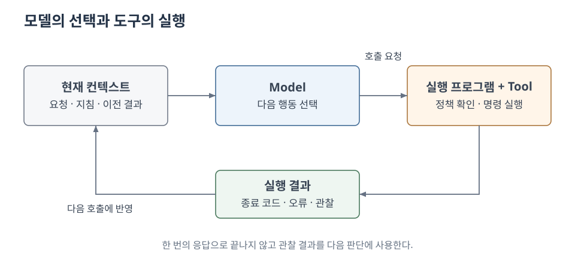
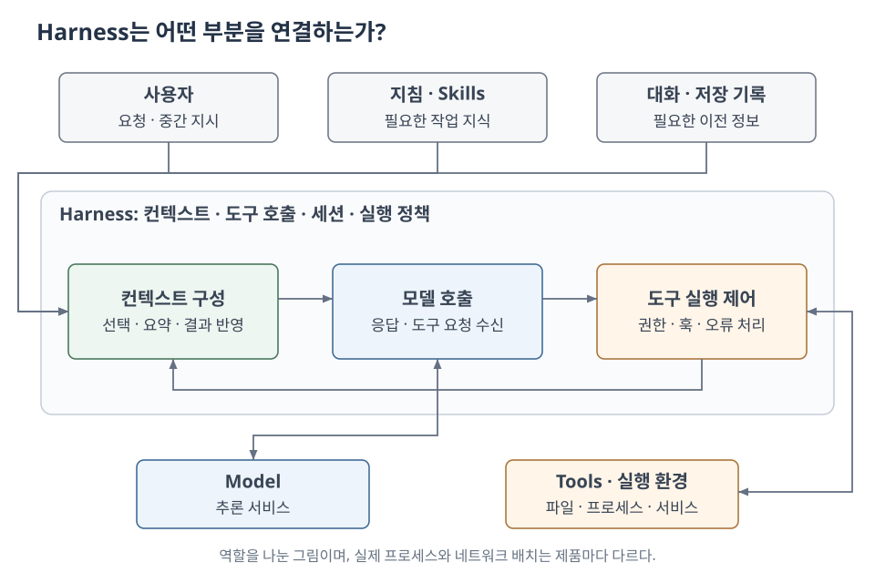
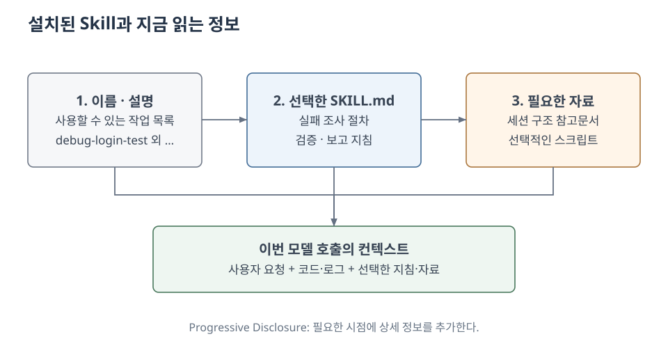
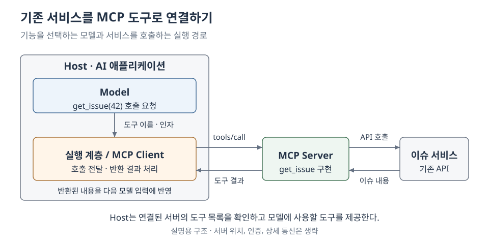
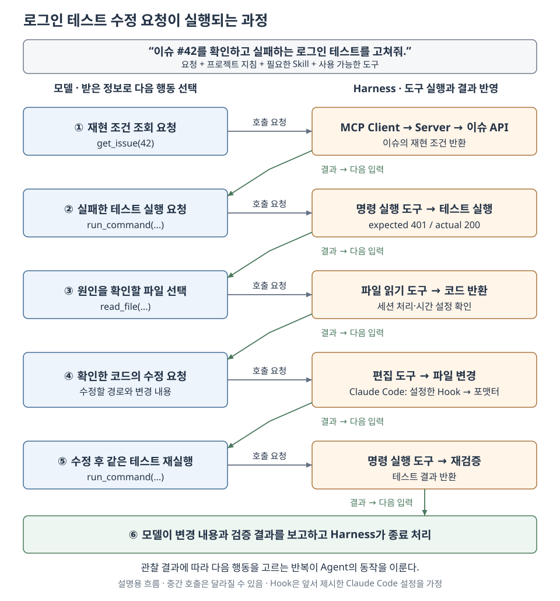

+++
date = '2026-09-25T21:00:00+09:00'
draft = false
title = '[Note] Agent, Harness, Skills 이해하기'
summary = '텍스트를 생성하는 모델이 실제 작업을 수행하기까지의 연결을 따라 Tool Calling, Agent·Workflow, Harness, Skills, MCP와 Hooks의 역할을 살펴본다.'
toc = true
tags = ['AI', 'Agent', 'Harness', 'Skills', 'Codex', 'Claude Code']
+++

---

## 들어가며

ChatGPT에 오류 메시지를 붙여 넣고 수정 방법을 물어본 적이 있을 것이다. 답변에 나온 코드를 에디터에 옮기고, 테스트를 실행한 뒤, 다시 실패하면 바뀐 오류를 전달한다. AI가 답변을 만들어 주더라도 실제 프로젝트에 적용하는 과정은 사람이 맡았다.

그런데 Codex나 Claude Code에서는 다음처럼 작업을 맡길 수 있다.

> 이 프로젝트에서 실패하는 로그인 테스트를 고쳐줘.

잠시 기다리면 파일을 검색하고, 테스트를 실행하고, 실패한 부분을 수정한다. 수정 뒤에도 테스트가 실패하면 오류를 읽고 다른 파일을 살펴보기도 한다. 사람이 답변을 복사해 옮기던 과정이 하나의 작업 안으로 들어온 것이다.

여기서 한 가지 의문이 생긴다. 우리가 채팅에서 사용하던 LLM은 입력된 문맥을 바탕으로 응답을 생성하는 모델이다. 코드나 명령어를 텍스트로 만들어 낼 수는 있지만, `pytest`라는 글자를 출력하는 것만으로 운영체제에서 테스트가 실행되지는 않는다.

**그렇다면 응답을 생성하던 모델이 어떻게 실제 파일을 수정하고 명령을 실행하게 된 것일까? 그 응답을 받아 실제 작업으로 옮기는 것은 무엇인가?**

이 연결을 따라가면 Tool Calling에서 시작해 Agent, Workflow, Harness, Skills가 필요한 이유가 차례로 드러난다. 이번 글에서는 로그인 테스트를 수정하는 상황을 따라 각 개념을 살펴보고, 마지막에 Codex와 Claude Code에서 일어나는 하나의 작업으로 다시 연결해 보려 한다.

---

## 모델의 응답은 어떻게 실제 작업으로 이어지는가?

채팅창에 `pytest tests/test_login.py -q`라는 답변이 나타났다고 생각해 보자. 이것은 아직 문자열이다. 하지만 프로그램이 그 문자열을 받아 프로세스를 실행하는 함수에 전달한다면, 같은 내용이 실제 명령 실행으로 이어질 수 있다.

이때 필요한 것은 모델의 응답과 실행할 함수를 연결하는 규칙이다. 실행 프로그램은 모델에 사용할 수 있는 기능의 이름과 설명, 입력 형식을 알려 준다. 모델은 그 규칙에 맞춰 어떤 기능을 어떤 값으로 호출할지 응답한다.

예를 들어 파일 탐색을 통해 로그인 테스트가 `tests/test_login.py`에 있다는 것을 확인했고, 명령 실행 기능이 제공돼 있다고 가정하자. 모델이 생성한 호출 요청을 필요한 부분만 남기면 다음과 같다.

```json
{
  "name": "run_command",
  "arguments": {
    "argv": ["pytest", "tests/test_login.py", "-q"]
  }
}
```

이 요청도 그 자체로는 실행되지 않는다. 요청을 받은 프로그램에 다음과 같은 코드가 있어야 한다. 파싱한 요청이 `call`에 들어 있다고 가정하고, 이름과 인자가 실제 함수에 연결되는 두 줄을 보면 된다.

```python
import subprocess


def run_command(argv):
    result = subprocess.run(argv, capture_output=True, text=True)
    return {"exit_code": result.returncode, "output": result.stdout + result.stderr}


registered_tools = {"run_command": run_command}

handler = registered_tools[call["name"]]
result = handler(**call["arguments"])
```

`name`이 `run_command`이므로 프로그램은 등록된 `run_command` 함수를 찾는다. 그리고 `arguments`의 `argv`를 함수에 전달한다. 이 함수 안의 `subprocess.run`이 프로세스를 시작하면서 모델이 요청한 명령이 실행된다.

이처럼 모델에 제공하는 실행 기능을 **Tool**, 모델이 기능과 인자를 지정해 호출을 요청하고 프로그램이 이를 실행하는 연결을 **Tool Calling**이라고 부른다. 함수의 이름과 입력 형식을 정의해 연결하는 [Function Calling](https://developers.openai.com/api/docs/guides/function-calling)이 이런 방식이다.

파일을 수정하는 경우에도 원리는 같다. 모델이 수정할 경로와 내용을 지정하면, 프로그램이 파일 편집 도구를 실행해 변경을 반영한다. 우리가 화면에서 보는 실제 행동은 모델의 응답이 도구 실행으로 연결된 결과다.

이제 텍스트와 실행 사이의 연결은 설명됐다. 그런데 처음 맡긴 일은 테스트 명령을 한 번 실행하는 데서 끝나지 않는다. 실행한 테스트가 실패했다면, 모델은 그 사실을 어떻게 알고 수정을 이어갈까?

---

## 실행 결과를 다시 모델에 넣으면 어떻게 되는가?

앞의 `run_command`가 다음 결과를 반환했다고 가정하자.

```text
exit_code: 1
FAILED test_expired_session_is_rejected
expected_status: 401
actual_status: 200
```

이 결과는 우선 실행 프로그램이 받는다. 모델이 실패 내용을 판단에 사용하려면, 프로그램이 이 결과를 넣어 모델을 다시 호출해야 한다.

다음 호출에는 처음의 사용자 요청과 앞서 생성한 도구 호출, 실행 결과가 함께 들어갈 수 있다. 모델은 이제 단순히 “로그인 테스트를 고쳐 달라”는 요청뿐 아니라, 만료된 세션에 `401` 대신 `200`이 반환됐다는 정보도 받는다. 이를 바탕으로 세션 처리 코드를 읽는 도구를 요청할 수 있고, 그 결과도 다시 다음 호출에 전달할 수 있다.

이렇게 현재 모델 호출에 제공하는 정보를 **Context**라고 한다. 아래 그림에서는 도구 실행 결과가 왼쪽의 컨텍스트로 돌아가는 경로를 따라가면 된다.



*모델 호출 → 도구 실행 → 결과 반영 → 다음 모델 호출의 반복.*

처음에는 테스트 결과를 몰랐지만 한 번의 실행으로 실패 조건을 알게 됐다. 관련 파일까지 읽었다면 다음에는 그 코드에 근거해 수정을 요청할 수 있다. 매번 받은 결과가 [다음 호출의 입력](https://developers.openai.com/api/docs/guides/function-calling#the-tool-calling-flow)을 바꾸며 작업이 진행되는 것이다.

이제 응답과 실행을 반복하는 **Loop**를 구성할 수 있다. 하지만 결과를 다시 넣는 것만으로 작업 순서까지 정해지는 것은 아니다. 인증 코드를 먼저 읽을지, 테스트의 시간 설정을 확인할지, 수정을 마쳤다고 판단할지는 누가 결정해야 할까? 개발자가 가능한 순서를 모두 정해 두어야 할까?

---

## Agent와 Workflow — 반복 안의 다음 행동은 누가 정하는가?

CI에서 테스트가 통과하면 빌드하고, 실패하면 보고서를 남기는 흐름은 익숙하다. 이때 오류 설명만 모델에 맡길 수도 있다. 이를 의사코드로 표현하면 다음과 같다.

```python
result = run_login_tests()

if result.failed:
    explanation = model.summarize(result.output)
    save_failure_report(explanation)
else:
    build_application()
```

모델은 오류를 어떻게 설명할지 결정한다. 하지만 실패 뒤에 보고서를 저장한다는 순서는 코드가 정했다. 여기에 정해진 횟수만큼 재시도하는 반복문을 추가하더라도, 어떤 단계로 넘어갈지는 여전히 미리 작성된 경로를 따른다.

반면 로그인 테스트의 원인을 찾아 수정하는 일에서는 조사 순서를 미리 정하기 어려울 수 있다. 인증 코드의 만료 검사가 정상이라면 테스트가 주입한 시계를 확인해야 하고, 검사 조건 자체가 빠져 있다면 해당 코드를 수정해야 한다. 방금 확인한 정보에 따라 다음 행동이 달라지는 것이다.

Anthropic은 [Building effective agents](https://www.anthropic.com/engineering/building-effective-agents)에서 미리 작성된 코드 경로로 모델과 도구를 연결하는 구성을 **Workflow**, 모델이 상황에 따라 실행 과정과 도구 사용을 정하는 구성을 **Agent**로 구분한다. 이 글에서는 이 구분을 기준으로 설명하겠다.

후자의 반복을 의사코드로 표현하면 다음과 같다.

```python
history = [user_request]

for _ in range(max_steps):
    response = model.respond(context=select_context(history), tools=tools)
    history.append(response)

    if response.needs_user_input:
        return ask_user(response.question)
    if not response.tool_calls:
        return response.message

    for call in response.tool_calls:
        result = run_allowed_tool(call)
        history.append(tool_result(call.id, result))

return report_limit_reached(history)
```

이 코드에는 `테스트 실패 → 인증 코드 → 시간 설정`이라는 조사 순서가 없다. 모델이 `run_command`를 요청하면 테스트를 실행하고, 실패 결과를 받은 뒤 `read_file`을 요청하면 파일을 읽는다. 그 내용을 받은 다음에는 수정하거나 다른 파일을 조사할 수 있다. `run_allowed_tool`은 앞에서 본 함수 연결에 실행 정책 확인 등을 더한 부분을 간략히 표시한 것이다.

따라서 **결과를 돌려주는 반복의 존재와, 그 반복 안에서 다음 행동을 모델이 선택하는지는 서로 구분해야 한다.** Workflow에도 반복이 들어갈 수 있다. 여기서 Agent라고 부르는 것은 목표를 위해 관찰 결과를 바탕으로 행동을 선택하고 실행을 이어가는 시스템이다. 이 글에서는 그 반복을 **Agentic Loop**, 작업 분배와 재계획까지 포함한 전체 흐름을 **Agentic Flow**라고 표현하겠다.

추론과 행동을 연결하고 환경의 관찰을 다음 판단에 활용하는 접근은 [ReAct 연구](https://arxiv.org/abs/2210.03629)에서도 다뤘다. Tool Calling이 실제 기능을 호출하는 연결을 설명한다면, ReAct는 추론·행동·관찰을 이어 가는 방식을 다룬다.

실제 시스템에서는 정해진 배포 Workflow 안에 실패를 조사하는 Agent를 넣을 수도 있다. 중요한 것은 제품 전체의 이름보다 어느 단계의 선택을 모델에 맡겼는지다.

그런데 앞의 코드에서도 모델이 하는 일은 `model.respond`에서 응답을 생성하는 부분이다. 결과를 보관하고, 다음 입력을 고르고, 요청된 도구를 실행하고, 반복을 멈추는 처리는 누가 맡고 있는가?

---

## Harness — 모델 주변에서 실행을 이어주는 것

앞의 반복문을 실제 제품으로 만든다고 생각해 보자. 모델이 사용할 수 있는 도구 목록을 제공해야 하고, 반환된 요청을 해당 도구로 연결해야 한다. 오류가 발생하면 그 결과를 전달하고, 실행 한도가 소진되거나 사용자가 중단하면 더 진행하지 않도록 처리해야 한다.

이처럼 모델을 둘러싸고 실행을 이어주는 프로그램을 **Harness**라는 관점에서 볼 수 있다. OpenAI는 [Codex Harness](https://developers.openai.com/blog/codex-as-a-platform)를 통해 에이전트 루프와 상태, 도구 실행을 다루는 기반을 설명한다. Claude Code도 [모델에 도구를 제공하고 컨텍스트를 관리하는 주변 계층](https://code.claude.com/docs/en/how-claude-code-works)을 agentic harness라고 부른다.

아래 그림에서는 모델을 호출하는 부분과 도구를 실행하는 부분 사이를 무엇이 연결하는지 살펴보자.



*모델 호출·컨텍스트·도구·실행 정책을 연결한 설명용 구조.*

모델은 주어진 도구 중 무엇을 사용할지 선택한다. Harness는 그 선택이 이루어질 입력과 도구 목록을 준비하고, 선택된 요청을 실행할 수 있는지 확인해 처리한다. 모델이 다음 행동을 고르는 일과 그 행동이 수행될 조건을 관리하는 일이 맞물리는 것이다.

반복을 끝내는 경우도 마찬가지다. 모델이 최종 답변을 반환해서 끝날 수 있지만, 실행 한도나 사용자 중단 때문에 끝날 수도 있다. 어떤 이유로 멈췄고 실제로 어떤 결과를 얻었는지가 함께 남아야 한다.

### 다음 호출에 무엇을 남길 것인가?

테스트를 열 번 실행하고 파일을 여러 개 읽었다면, 앞의 `history`에는 코드와 오류 로그가 계속 쌓인다. 이를 모두 매번 전달하면 입력이 길어지고, 지금 필요한 조건을 찾기도 어려워진다. Harness는 다음 호출에 필요한 기록을 고르거나 요약하고, 필요할 때 원문을 다시 읽을 수 있도록 연결한다. 이러한 입력 구성의 문제를 [Context Engineering](https://www.anthropic.com/engineering/effective-context-engineering-for-ai-agents)의 관점으로 볼 수 있다.

예를 들어 조사 중 테스트의 시계와 인증 코드가 다른 시간 기준을 사용한다는 사실을 알아냈다면, 이후에는 그 조건과 수정한 위치, 남은 검증을 유지해야 한다. 방금 읽은 파일을 잊고 같은 조사를 반복하지 않게 하는 일도 실행을 이어가는 데 포함된다.

이때 기록을 저장해 두는 것과 이번 모델 호출에 넣는 것은 다르다. **Memory**를 정보의 보존과 재사용, **Context**를 현재 호출에 실제로 제공된 정보로 나누어 보면 차이가 드러난다. 원본 로그가 남아 있어도 다시 읽거나 입력에 포함하지 않았다면 그 세부 내용이 현재 판단에 쓰이지 않을 수 있다. Memory의 구체적인 기능과 저장 방식은 제품마다 다르다.

대화를 재개할 때는 기록에 남은 조건이 여전히 유효한지도 확인해야 한다. 테스트 서버가 종료됐거나 파일이 바뀌었다면 그 상태부터 다시 살펴보는 것이다.

### 지침과 실행 조건은 어디에 적용되는가?

사용자가 “인증 정책은 바꾸지 말고 테스트 환경부터 확인해줘”라고 지시했다면, 다음 모델 호출에 그 내용이 제공돼야 한다. 반면 파일 쓰기나 네트워크 접근의 제한은 실행 경로에서 적용해야 한다. 지침을 읽고 행동을 선택하는 것과 실제로 그 행동을 허용하는 것은 적용 위치가 다르다.

Sandbox와 승인 절차는 이 실행 조건을 다루는 예다. 제품과 설정에 따라 Harness나 외부 실행 환경이 접근 범위와 승인 시점을 관리한다.

이제 모델에 도구를 제공하고 작업을 이어 가는 공통 구조는 갖춰졌다. 하지만 로그인 오류를 조사할 때마다 확인해야 하는 프로젝트의 규칙과 절차까지 이 구조가 저절로 알려 주지는 않는다. 같은 종류의 작업을 맡길 때마다 그 설명을 반복해야 할까?

---

## Skills — 특정 작업의 지침을 어떻게 재사용하는가?

로그인 테스트를 고칠 때마다 “먼저 실패를 재현하고, 계정·시간·세션 조건을 구분해 확인한 뒤, 수정 후 같은 테스트를 다시 실행하라”고 설명한다고 생각해 보자. 이 절차는 다른 로그인 문제에도 재사용할 수 있지만, 화면의 문구를 바꾸는 작업에는 필요하지 않을 수 있다.

그렇다면 이 지침을 작업별로 저장해 두었다가 해당 작업을 할 때 읽게 만들 수 있다. **Skill**은 이러한 지침과 참고자료, 필요하다면 스크립트를 함께 묶는 단위다. [Agent Skills 명세](https://agentskills.io/specification)는 `SKILL.md`에 이름·설명과 지침을 두는 형식을 정의한다.

```text
debug-login-test/
├── SKILL.md
├── references/
│   └── session-lifecycle.md
└── scripts/
    └── summarize-test-output.py
```

가상의 `SKILL.md`를 작성하면 다음과 같다.

```markdown
---
name: debug-login-test
description: 로그인·세션 테스트가 실패했을 때 원인을 조사하고 수정 결과를 확인한다.
---

1. 실패한 테스트를 실행해 현재 결과를 확인한다.
2. 기대 동작을 확인한 뒤 계정·시간·세션 조건을 나누어 조사한다.
3. 응답 코드만 맞추지 말고 실패 원인을 확인해 수정한다.
4. 같은 테스트와 관련 회귀 테스트를 다시 실행한다.
5. 확인한 결과와 아직 검증하지 못한 부분을 구분해 보고한다.

세션 구조가 필요하면 references/session-lifecycle.md를 읽는다.
```

이 파일을 읽은 모델은 실패한 응답 코드만 고치는 대신, 세션과 시간 조건을 확인하는 절차를 참고할 수 있다. 이번 작업에서 사용할 지식과 절차를 모델의 입력으로 제공하는 것이다. `references`나 `scripts`는 필요할 때 추가한다.

프로젝트 전체에 공통으로 적용할 지침도 있다. 예를 들어 테스트 명령이나 패키지 관리자는 Codex의 [`AGENTS.md`](https://learn.chatgpt.com/docs/agent-configuration/agents-md), Claude Code의 [`CLAUDE.md`](https://code.claude.com/docs/en/memory)에 남길 수 있다. 그 위에 특정 작업에서 필요한 절차를 Skill로 따로 제공하면, 공통 규칙과 작업별 설명을 나누어 관리할 수 있다.

그런데 재사용할 Skill이 많아지면 모든 지침을 처음부터 읽혀야 할까? 앞에서 본 것처럼 현재 컨텍스트에 넣을 정보도 관리해야 한다.



*사용할 지침을 고른 뒤 상세 자료를 가져오는 Progressive Disclosure.*

먼저 이름과 설명으로 어떤 작업에 쓸 수 있는지 확인하고, [선택한 Skill의 본문과 필요한 참고자료](https://learn.chatgpt.com/docs/build-skills)를 이어서 읽는다. 이렇게 현재 작업에 필요한 지침부터 컨텍스트에 넣을 수 있다.

Skill에 적힌 절차는 모델이 다음 행동을 고를 때 참고한다. 특정 단계를 반드시 실행하게 하려면 앞에서 본 Workflow처럼 코드의 실행 경로에 넣어야 한다. Skill로 작업별 지침을 재사용하면서, 실행 루프와 권한 처리는 Harness에 두는 구조다.

이제 같은 작업을 수행하는 방법을 반복해서 설명할 필요는 줄었다. 하지만 지침에 “이슈의 재현 조건을 확인하라”고 적었는데 그 이슈가 외부 서비스에만 있다면 어떨까? 모델에게 읽으라고 알려 주는 것과 실제로 읽을 수 있는 기능을 제공하는 것은 다른 문제다.

---

## MCP — 기존 서비스를 모델이 사용할 도구로 연결하기

이슈 관리 서비스에 로그인 테스트의 재현 조건이 적혀 있다고 가정하자. 사람은 브라우저를 열어 이슈를 읽을 수 있지만, 모델이 사용할 수 있는 도구가 파일 읽기와 명령 실행뿐이라면 이슈 조회 기능이 자동으로 생기지는 않는다. 서비스의 API를 호출하고 내용을 반환하는 연결을 만들어야 한다.

앞의 Tool Calling 구조에 `get_issue`라는 함수를 추가하는 방식으로도 이를 구현할 수 있다. 그런데 같은 기능을 Codex, Claude Code, 별도로 만든 AI 애플리케이션에 연결하려면, 각 프로그램이 도구를 발견하고 호출하는 방식을 맞춰야 한다.

**MCP(Model Context Protocol)**는 이 연결에 사용할 수 있는 공통 규약이다. 기존 서비스의 기능을 MCP Server의 도구로 제공하면, 이를 지원하는 AI 애플리케이션이 MCP Client를 통해 기능 목록을 확인하고 호출할 수 있다. [공식 아키텍처](https://modelcontextprotocol.io/docs/2026-07-28/learn/architecture)에서 애플리케이션은 Host, 연결을 담당하는 구성 요소는 Client, 기능과 자료를 제공하는 프로그램은 Server로 구분한다.



*이미 구현된 이슈 조회 기능을 MCP로 연결한 가상 사례.*

그림 오른쪽의 이슈 서비스 API를 호출하고 결과를 반환하는 함수를 Server 쪽에 등록해야 한다. 필요한 관계만 의사코드로 표현하면 다음과 같다.

```python
def get_issue(issue_id):
    issue = issue_service.fetch_issue(issue_id)
    return {"title": issue.title, "body": issue.body}

register_mcp_tool(
    name="get_issue",
    description="이슈 번호로 제목과 재현 조건을 조회한다.",
    input_schema={"issue_id": "integer"},
    handler=get_issue,
)
```

Host는 Client를 통해 서버의 도구 목록을 얻고 필요한 도구 설명을 모델에 제공한다. 모델이 `get_issue(issue_id=42)`를 요청하면, 실행 측이 그 요청을 MCP Server로 전달한다. 서버의 `get_issue`가 기존 API를 호출한 뒤 결과를 반환하고, 그 내용은 다시 모델의 입력으로 들어간다. 도구 목록 조회와 실행에는 각각 `tools/list`, `tools/call` 같은 MCP 메서드가 사용된다.

앞에서 본 Tool Calling의 실행 경로 중 하나가 MCP 연결을 거쳐 외부 서비스까지 확장된 것이다. 로컬 명령 실행이나 파일 편집처럼 MCP를 거치지 않는 도구도 함께 사용할 수 있다. 또한 MCP는 도구 외에 리소스와 프롬프트도 다루며, 이번 예시는 그중 도구 연결에 초점을 맞췄다.

이제 Skill에 적힌 절차를 읽고, 필요한 정보를 외부 서비스에서 가져오고, 코드를 수정할 수 있다. 그런데 파일을 수정할 때마다 같은 포맷터를 실행해야 한다면, 그때마다 모델이 이 규칙을 기억하고 다음 행동으로 선택하게 해야 할까?

---

## Hooks — 정해진 처리를 매번 모델이 선택해야 할까?

“파일을 수정한 뒤 포맷터를 실행하라”는 문장을 지침에 넣을 수 있다. 그러면 모델은 다음 행동을 고를 때 그 내용을 참고한다. 하지만 파일 수정 직후 항상 같은 명령을 실행하려는 목적이라면, 실행 프로그램의 해당 이벤트에 명령을 연결할 수도 있다.

**Hook**은 이런 실행 시점에 붙이는 처리다. 여기서는 모델을 추가로 호출하지 않고 명령을 실행하는 **command hook**을 기준으로 살펴보겠다.

예를 들어 Claude Code에서는 `PostToolUse` 이벤트와 `Edit|Write` 조건을 사용해 해당 편집 도구의 실행이 성공한 뒤 명령을 실행하도록 설정할 수 있다. 아래는 [공식 Hooks 가이드](https://code.claude.com/docs/en/hooks-guide#auto-format-code-after-edits)의 이벤트 구조를 사용한 설정 예시다. `format_changed_file.py`는 표준 입력으로 전달된 이벤트 JSON에서 파일 경로를 읽어 포맷터를 실행하도록 별도로 준비했다고 가정한다.

```json
{
  "hooks": {
    "PostToolUse": [
      {
        "matcher": "Edit|Write",
        "hooks": [
          {
            "type": "command",
            "command": "python3 scripts/format_changed_file.py"
          }
        ]
      }
    ]
  }
}
```

이 설정에서는 모델이 `Edit`나 `Write`를 선택해 파일을 수정하면, 실행 측이 조건에 맞는 Hook을 호출한다. 모델이 다음 응답에서 포맷터 실행을 다시 선택할 필요가 없다. 매번 같은 규칙을 떠올려 행동을 결정하는 부담을 일부 실행 코드로 옮긴 것이다.

위 설정이 적용되는 범위는 `Edit|Write`와 일치하는 도구가 성공한 시점이다. Bash로 파일을 수정하는 경로까지 처리하려면 [매칭 조건](https://code.claude.com/docs/en/hooks)을 조정해야 한다. 포맷터 자체가 실패한 경우의 처리도 함께 정해 두어야 한다.

Hook의 오류나 필요한 결과는 다음 모델 호출에 전달할 수 있다. 반복 작업은 이벤트에 연결된 코드가 처리하고, 모델은 돌아온 결과를 바탕으로 후속 작업을 판단하게 된다.

이제 판단이 필요한 부분은 모델에, 반복해서 같은 조건을 처리하는 부분은 코드에 둘 수 있다. 앞에서 살펴본 구성들이 실제 코딩 도구의 한 번의 작업 안에서는 어떻게 맞물리는지 돌아보자.

---

## Codex와 Claude Code의 작업을 처음부터 따라가 보기

다시 처음의 요청을 Codex CLI나 Claude Code에 입력했다고 가정하자.

> 이슈 #42에 적힌 재현 조건을 확인하고, 실패하는 로그인 테스트를 고쳐줘.

프로젝트에는 앞에서 만든 로그인 조사 Skill이 있고, 이슈 조회 MCP 서버도 연결돼 있다고 하자. Claude Code의 경우 파일 편집 뒤에 포맷터를 실행하는 command hook까지 설정돼 있다.



*모델의 선택과 Harness의 실행 처리를 한 작업에 대응시킨 예시.*

### 요청과 지침이 모델의 입력으로 들어간다

처음에는 사용자의 요청과 프로젝트 지침, 사용할 수 있는 도구 정보가 준비된다. Codex의 `AGENTS.md`, Claude Code의 `CLAUDE.md`에서 테스트 명령과 수정 규칙을 전달할 수 있고, 이번 작업에 해당하는 Skill의 절차를 읽으면 그 내용도 이후 판단의 자료가 된다. 어떤 파일을 언제 읽고 어느 지침을 적용하는지는 각 제품의 규칙을 따른다.

이 입력을 받은 **모델**은 필요한 정보를 판단한다. 이슈의 재현 조건이 아직 없으므로 `get_issue`를 요청할 수 있다.

### 선택한 도구가 실행되고 결과가 돌아온다

**Harness의 실행 경로**는 도구 요청을 받아 허용 여부를 확인하고, 연결된 MCP Client를 통해 해당 Server에 호출을 전달한다. Server는 기존 서비스에서 이슈 #42를 조회해 반환한다. 이 결과가 컨텍스트에 들어간 뒤 모델을 다시 호출하면, 모델은 이제 재현 조건을 바탕으로 테스트 명령을 선택할 수 있다.

선택된 테스트 명령은 로컬 실행 환경의 명령 실행 도구가 수행한다. 실패 결과가 돌아오면 Harness는 호출과 결과를 연결해 기록하고 다음 입력에 반영한다.

### 실패를 본 모델이 다음 행동을 바꾼다

테스트 결과가 `expected 401, actual 200`이었다면, 모델은 세션 처리 코드를 읽거나 테스트의 시간 설정을 확인할 수 있다. 파일을 읽은 결과도 다시 입력으로 들어오며, 모델은 새로 얻은 정보에 따라 수정할 위치를 고른다.

이처럼 목표를 두고 관찰 결과에 따라 다음 행동을 선택하는 전체 동작이 앞서 설명한 **Agent의 동작**이다. 테스트 실패를 확인한 뒤 조사할 파일을 고르고, 그 코드에 근거해 수정을 요청하는 과정에서 모델이 작업의 경로를 바꾸고 있다.

작업 중 로그가 길어지면 Harness는 다음 호출에 남길 내용을 관리한다. 사용자가 중간에 수정 범위를 바꾸면 새 지시를 반영한다. 모델의 판단은 매번 제공된 컨텍스트 안에서 이루어지므로, 이 주변 처리가 이어지는 조사에도 영향을 준다.

### 파일 수정 뒤에는 설정된 처리가 연결된다

모델이 수정 내용을 요청하면 편집 도구가 파일에 반영한다. 앞의 Claude Code 설정에서는 해당 편집 도구가 성공한 뒤 `PostToolUse` Hook이 포맷터 스크립트를 실행한다.

수정 뒤에 테스트를 다시 실행할지, 실패가 남았다면 어디를 더 조사할지는 이어지는 모델 호출에서 판단할 수 있다. 만약 특정 검사를 반드시 통과해야만 완료하도록 만들고 싶다면, 그 조건은 적절한 Workflow나 종료 검사 코드에 연결해야 한다. Skill에 “검증하라”고 적는 것과 코드가 완료 조건을 검사하는 것은 앞에서 본 차이다.

### 확인한 결과를 바탕으로 작업을 마친다

테스트가 통과하고 필요한 검증을 마쳤다면 모델은 변경 내용과 확인한 결과를 정리해 답변할 수 있다. 반대로 실행 한도에 도달하거나 사용자 입력이 더 필요하면 성공과 다른 이유로 멈출 수 있다. Harness는 이 종료를 처리하고, 사용자에게는 무엇을 확인했고 무엇이 남았는지가 전달돼야 한다.

처음의 한 문장 뒤에는 이런 과정이 이어진다. 모델이 응답을 생성할 때 필요한 행동을 선택하고, 실행 프로그램이 그 응답을 도구 호출로 처리한다. 돌아온 결과가 다음 판단의 입력이 되고, 이 반복을 유지하는 Harness 안에서 필요한 Skill·MCP 연결·Hook이 각자의 역할을 수행한다.

---

## 마치며

처음에는 텍스트로 답하던 AI가 파일을 고치고 테스트까지 실행한다는 점이 의문이었다. 그 사이에는 모델의 호출 요청을 실제 함수로 연결하는 코드가 있었고, 한 번 실행한 뒤에는 결과를 다시 모델에 전달하는 과정이 있었다.

이 글에서 살펴본 **Agent는 모델이 주어진 목표와 관찰 결과를 바탕으로 다음 행동과 도구 사용을 선택하며 작업을 이어가는 시스템이다.** **Harness는 그 작업이 이어지도록 모델 호출, 도구 실행, 컨텍스트와 상태, 실행 제약과 종료 처리를 연결하고 관리하는 실행 기반이다.**

이 구조를 알고 나면 같은 모델을 사용하면서도 지침을 추가하거나 도구를 연결했을 때 작업 방식이 달라지는 이유를 이해할 수 있다. 모델에 어떤 정보와 선택지를 제공하고, 선택된 행동을 어떻게 실행하며, 그 결과를 다음 판단에 어떻게 남기는지가 달라지기 때문이다.

앞으로 AI 도구의 새로운 기능을 보더라도 이 흐름 안에서 위치를 찾아볼 수 있다. 작업 방법을 알려 주는 것인지, 실제로 할 수 있는 일을 늘리는 것인지, 특정 조건에서 실행을 제어하는 것인지 살펴보면 그 기능이 필요한 이유도 함께 드러난다.

---

> 참고자료  
> https://developers.openai.com/api/docs/guides/function-calling  
> https://www.anthropic.com/engineering/building-effective-agents  
> https://arxiv.org/abs/2210.03629  
> https://developers.openai.com/blog/codex-as-a-platform  
> https://code.claude.com/docs/en/how-claude-code-works  
> https://www.anthropic.com/engineering/effective-context-engineering-for-ai-agents  
> https://agentskills.io/specification  
> https://learn.chatgpt.com/docs/build-skills  
> https://learn.chatgpt.com/docs/agent-configuration/agents-md  
> https://code.claude.com/docs/en/memory  
> https://modelcontextprotocol.io/docs/2026-07-28/learn/architecture  
> https://code.claude.com/docs/en/hooks-guide#auto-format-code-after-edits  
> https://code.claude.com/docs/en/hooks  
